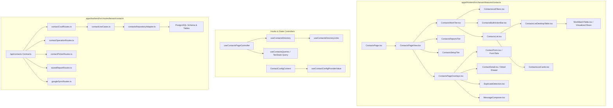

# Complete Project & Contacts Module Technical Audit — TMS MMS

**Target Surface:** Contacts Module (`/contacts` on `https://tms.mmsv2.aabtaab.com/contacts`)  
**Role:** Senior Full-Stack Developer & Software Architect  
**Audit Status:** Complete (Read-Only Inspection — Zero Code Modifications Applied)

---

## 1. Project Architecture

The Madrasa Management System (MMS) is a multi-tenant monorepo architecture managed by **pnpm workspaces** and **Turborepo**:

- **Frontend Application (`apps/frontend/`):**
  - **Framework:** React 19 (`react: ^19.3.1`, `react-dom: ^19.3.1`) built with **Vite 8** (`vite: ^8.3.5`).
  - **State & Server Authority:** TanStack Query v5 (`@tanstack/react-query: ^5.104.5`) coupled with `@ts-rest/core` & `@ts-rest/react-query` contract definitions.
  - **Styling:** Tailwind CSS v4 (`@tailwindcss/vite: ^4.1.18`, `@import "tailwindcss"`) and BiDi / RTL directional tokens.
  - **Routing:** React Router v7 (`react-router-dom: ^7.18.4`).
- **Backend Application (`apps/backend/`):**
  - **Framework:** Fastify 5 (`fastify: ^5.12.7`) with `@fastify/jwt`, `@fastify/cookie`, `@fastify/rate-limit`, `@fastify/websocket`, and `@ts-rest/fastify`.
  - **Runtime:** Node.js 24 Alpine (`>=24.14.0`).
  - **Background Worker & CDC:** BullMQ 6 (`bullmq: ^6.4.2`) running on Redis 7 Alpine with Outbox CDC pattern.
- **Database & Data Layer (`apps/backend/src/db/`):**
  - **Database:** PostgreSQL 16 Alpine.
  - **ORM & Query Builder:** Drizzle ORM (`drizzle-orm: ^0.45.4`) with forward-only SQL migrations (`drizzle-kit: ^0.31.11`).
  - **Multi-Tenancy & Security:** Multi-tenant single database enforced through PostgreSQL Row Level Security (`FORCE ROW LEVEL SECURITY`) with non-superuser role `mms_app` (`NOSUPERUSER NOBYPASSRLS`), scoped via `app.current_tenant` GUC and RFC 8785 JSON audit trails.
- **Shared Package (`packages/shared/`):**
  - Single Source of Truth (`@mms/shared`) for data contracts, Zod DTO schemas, module manifests, permissions, and domain utilities.

---

## 2. Contacts Module Architecture

The Contacts module follows the **Three-Tier Universal Module Scaffold** (`work`, `reports`, `setup`):



---

## 3. File-by-File Component Overview

### Core Module Entry & Page Shell

- `apps/frontend/src/tenant/features/contacts/ContactsPage.tsx`: Minimal boundary lazy-loaded entry; invokes `useContactsPageController`.
- `apps/frontend/src/tenant/features/contacts/components/ContactsPageView.tsx`: Top-level 3-tier presentation wrapper (`ModuleTierPage`); passes metrics, banners, and overlays.
- `apps/frontend/src/tenant/features/contacts/components/ContactsCommandMetrics.tsx`: Quick metrics dashboard widgets (Total, Filtered, Pending Sync, Conflicts, Duplicates).
- `apps/frontend/src/tenant/features/contacts/components/ContactsDataBanner.tsx`: Shows sync/status notifications and offline queue badges.
- `apps/frontend/src/tenant/features/contacts/components/ContactsSyncConflictPanel.tsx`: Accordion/dialog resolving bidirectional sync conflicts.
- `apps/frontend/src/tenant/features/contacts/components/ContactsPageHeaderActions.tsx`: Action buttons (`Add Contact`, `Export CSV`, `Import`, `Detect Duplicates`).

### Work Tier Directory & Tables

- `apps/frontend/src/tenant/features/contacts/components/ContactsWorkTier.tsx`: Orchestrates filters, bulk actions, and the active view mode (table vs cards).
- `apps/frontend/src/tenant/features/contacts/components/ContactsListFilters.tsx`: Search bar, gender dropdown, quick-filter chips, and sorting controls.
- `apps/frontend/src/tenant/features/contacts/components/ContactsBulkActionBar.tsx`: Appears when rows are selected; provides bulk WhatsApp, SMS, Email, Tag, Export, and Delete buttons.
- `apps/frontend/src/tenant/features/contacts/components/ContactsList.tsx`: Switches between `ContactsListDesktopTable` and `ContactsListCards` or displays `ModuleWorkDirectoryEmpty`.
- `apps/frontend/src/tenant/features/contacts/components/ContactsListDesktopTable.tsx`: Heavy table rendering powered by `@/components/common/work/WorkBatchTable`.
- `apps/frontend/src/tenant/features/contacts/components/ContactTableCells.tsx`: Cell renderers for identity, tags, phone formatting, country flags, and dynamic custom fields.
- `apps/frontend/src/tenant/features/contacts/components/ContactTableRow.tsx`: Action triggers and sticky action menus.
- `apps/frontend/src/tenant/features/contacts/components/ContactsListCards.tsx`: Responsive mobile-first card list rendering.

### Overlays & Detail Drawer

- `apps/frontend/src/tenant/features/contacts/components/ContactsPageOverlays.tsx`: Container for lazy-loaded overlays:
  - `ContactForm.tsx`: Create / edit multi-tab modal (`ContactBasicIdentityFields`, `ContactPhonesTab`, `ContactAddressesTab`, `ContactBankDetailsTab`, `ContactSkillsTab`, `ContactRelationshipTab`).
  - `ContactDetail.tsx`: Side drawer for viewing contact identity, relations, activities, and communication logs.
  - `DuplicateDetection.tsx`: Levenshtein/phonetic identity matcher and merge workflow.
  - `ContactsImportDialog.tsx` & `ContactsCsvImportDialog.tsx`: CSV and tabular batch onboarding modal.
  - `ContactsPageConfirmDialogs.tsx`: Delete, bulk-delete, and restore confirmation prompts.

### Hooks & Controllers

- `useContactsPageController.ts`: Master orchestrator coordinating filters, queries, actions, overlays, and permissions.
- `useContactsDirectory.ts`: Handles pagination, search debounce, sort states, and invokes server-query hook.
- `useContactsDirectoryLinks.ts`: Resolves family/relationship links and sibling references for all contacts rendered in the current view.
- `useContactsQueries.ts`: TanStack Query contracts (`tsrClient.contacts.list`, `tsrClient.contacts.get`, mutations).
- `apps/frontend/src/lib/contexts/ContactConfigContext.tsx`: App-wide context provider fetching field configs, lookups, and preferences at tenant root.

---

## 4. API Endpoint Overview

All endpoints are validated through `@ts-rest/core` contracts (`packages/shared/src/contracts/contacts.contract.ts`) and implemented in Fastify (`apps/backend/src/routes/tenant/contacts/`):

| Method   | Path                         | Authentication / Guard  | Description                                                     |
| :------- | :--------------------------- | :---------------------- | :-------------------------------------------------------------- |
| `GET`    | `/api/contacts`              | `contacts.read`         | Paginated list of contacts with search, gender filter, and sort |
| `POST`   | `/api/contacts`              | `contacts.write` + RLS  | Create contact or CAS upsert (`x-expected-updated-at`)          |
| `GET`    | `/api/contacts/:id`          | `contacts.read`         | Fetch full contact record with relations, phones, emails, tags  |
| `PUT`    | `/api/contacts/:id`          | `contacts.write`        | CAS update contact (`x-expected-updated-at`)                    |
| `DELETE` | `/api/contacts/:id`          | `contacts.delete`       | Soft-delete contact with audit log & deletion reason            |
| `POST`   | `/api/contacts/:id/restore`  | `contacts.delete`       | Restore soft-deleted contact from trash                         |
| `POST`   | `/api/contacts/bulk-delete`  | `contacts.delete`       | Batch soft-delete selected contacts                             |
| `POST`   | `/api/contacts/bulk-restore` | `contacts.delete`       | Batch restore contacts                                          |
| `POST`   | `/api/contacts/bulk-tag`     | `contacts.write`        | Add/remove tags on multiple contacts                            |
| `POST`   | `/api/contacts/merge`        | `contacts.write`        | Merge duplicate contacts into single record                     |
| `GET`    | `/api/contacts/metrics`      | `contacts.read`         | Load module quick stats & duplicate pair counters               |
| `GET`    | `/api/contacts/picker`       | Open / Cross-module     | Lightweight contact search for student/faculty linking          |
| `GET`    | `/api/contacts/field-config` | `configuration.view`    | Contact custom fields, system tabs, and layout config           |
| `PUT`    | `/api/contacts/field-config` | `settings.global.write` | Update contact field configuration                              |
| `GET`    | `/api/contacts/lookups`      | `contacts.read`         | Lookups for genders, degrees, platforms, relationships          |
| `GET`    | `/api/contacts/preferences`  | `contacts.read`         | Contact module preferences & defaults                           |
| `GET`    | `/api/contacts/export/csv`   | `contacts.read`         | Streamed CSV export of active or filtered contacts              |

---

## 5. Current Performance Bottlenecks

Reference metrics: **LCP = 8.6s**, **Performance Score = 61**.

### 1. N+1 Link Resolution Waterfall (`useContactsDirectoryLinks.ts`)

- **Inspection Finding:** In `useContactsDirectory.ts`, every time the contacts list renders, it calls `useContactsDirectoryLinks`. That hook collects all `linkedContactIds` and fires a secondary `useContactsByIds(linkedContactIds)` query, then computes siblings and fires **another** `useContactsByIds(siblingContactIds)` query.
- **Impact:** Causes a 2-stage request waterfall on initial render before the table relationships settle.

### 2. Global Provider Over-Fetching (`ContactConfigProvider` in `TenantScopedProviders.tsx`)

- **Inspection Finding:** `TenantScopedProviders` mounts `ContactConfigProvider` globally across the entire tenant workspace:
  - Fires `/api/contacts/preferences`
  - Fires `/api/contacts/lookups`
  - Fires `/api/contacts/field-config`
  - Calculates wide arrays (`countryCodes`, `educationDegrees`, etc.) regardless of whether the user is on Dashboard, Students, or Contacts.
- **Impact:** Adds multiple simultaneous REST queries during initial boot, delaying FCP and competing for network bandwidth with the route loader.

### 3. Google Fonts Render-Blocking in `index.html`

- **Inspection Finding:** `index.html` loads two external Google Webfont CSS stylesheets synchronously:
  - `https://fonts.googleapis.com/css2?family=Inter:wght@400;500;600;700;800&display=swap`
  - `https://fonts.googleapis.com/css2?family=Plus+Jakarta+Sans:wght@300;400;500;600;700&display=swap`
- **Impact:** External CSS stylesheet requests directly block initial layout and paint, inflating First Contentful Paint (1.6s) and LCP (8.6s).

### 4. Monolithic CSS File Size

- **Inspection Finding:** `apps/frontend/src/index.css` is **54.4 KB** of unminified custom utility classes and tokens before processing. Coupled with `@import "tailwindcss"` and `@import "tw-animate-css"`, the parsed stylesheet size blocks initial rendering.

### 5. Table Re-render Cost (`ContactsListDesktopTable.tsx`)

- **Inspection Finding:** While `ContactsListDesktopTable` is wrapped in `React.memo`, `columns.map` builds inline render functions passing deep closures (`contactsMap`, `allContacts`, `prefs`, `countryCodesMap`, `t`) on every state change (such as ticking a single checkbox or typing in search).
- **Impact:** Re-creates the column definitions array and re-evaluates all visible row cells.

---

## 6. Accessibility (a11y) Findings

Reference score: **Accessibility: 98**.

- **Positives:**
  - Form fields use explicit labels, `aria-required`, and standard Radix UI primitives.
  - Table selection checkboxes utilize localized `aria-label` (`selectAllAriaLabel`, `selectRowAriaLabel`).
  - Dark mode maintains semantic contrast through HSL design tokens.
- **Potential Gaps:**
  - In `ContactsListDesktopTable.tsx`, cell action trigger buttons (`ContactsRowActions`) rely on three-dot icons that need guaranteed accessible names in all locales.
  - In `ContactsListFilters.tsx`, filter chips clearing buttons must provide explicit `aria-label` descriptions for screen readers.

---

## 7. SEO Configuration Problems

Reference score: **SEO: 58**.

- **Inspection Finding:**
  - `index.html` contains:
    ```html
    <meta name="robots" content="noindex, nofollow" />
    ```
  - The application is an authenticated multi-tenant SaaS portal. Lighthouse penalizes `noindex` under the SEO audit category.
  - Missing canonical URL link (`<link rel="canonical" href="..." />`) on public landing or registration pages (`/apply`).
  - Dynamic page titles in `ContactsPageView.tsx` rely on client-side JS execution (`seoTitleKey: "page.contacts.seoTitle"`), leaving the HTML title static as `MMS - Madrasa Management System` before hydration.

---

## 8. Security & Multi-Tenancy Review

- **Tenant Isolation:**
  - Robust multi-tenancy enforcement in backend: every query executes with `withTenant(subdomain, ...)` or `withTenantRead(...)`, executing `SET LOCAL app.current_tenant = $1` with PostgreSQL Row-Level Security (`FORCE ROW LEVEL SECURITY`).
  - The database connection uses `mms_app` which has `NOSUPERUSER NOBYPASSRLS` privileges; superuser bypass is explicitly guarded at boot via `assertRlsRuntimeRole`.
- **Soft-Delete System:**
  - Contacts are never hard-deleted in production; `deleted_at`, `deleted_by`, and `deletion_reason` are captured in `tenant_users`/`contacts` tables with index guards.
- **Optimistic Concurrency:**
  - Contact mutations utilize `x-expected-updated-at` headers. The server executes `saveContactIfVersionMatches` and returns `409 Conflict` on concurrent collisions, preventing silent overwrites.

---

## 9. Recommended Optimization Strategy

1. **Eliminate Render-Blocking Webfonts:**
   - Preload primary webfonts using self-hosted woff2 or use asynchronous font loading (`display=swap`, font preconnects, or `font-display: optional`).
2. **Optimize Contacts Directory Link Resolution:**
   - In `useContactsDirectoryLinks.ts`, defer or debounce sibling/relationship resolution so that the primary table renders immediately from `workContacts` without waiting for secondary link queries.
3. **Decouple Setup Queries from Tenant Boot:**
   - In `ContactConfigProvider`, lazy-load or cache lookup queries with larger `staleTime` (e.g. 5–10 minutes) so page switching does not re-validate lookups.
4. **Stabilize Table Column Memoization:**
   - Hoist `renderContactTableCell` helper dependencies into stable references so selecting/deselecting a row does not reconstruct all column definitions.
5. **SEO & PWA Headers:**
   - Ensure public admission paths (`/apply`) have search-engine crawlable meta tags while retaining `noindex` only on private tenant routes.

---

## 10. List of Files Likely Requiring Modifications (in Phase 2)

| File Path                                                                            | Purpose of Anticipated Optimization                              |
| :----------------------------------------------------------------------------------- | :--------------------------------------------------------------- |
| `apps/frontend/index.html`                                                           | Font loading strategy & SEO meta tag optimization                |
| `apps/frontend/src/tenant/features/contacts/hooks/useContactsDirectoryLinks.ts`      | Eliminate waterfall / defer sibling link queries                 |
| `apps/frontend/src/tenant/features/contacts/components/ContactsListDesktopTable.tsx` | Stabilize column and cell memoization to prevent full re-renders |
| `apps/frontend/src/lib/contexts/ContactConfigContext.tsx`                            | Stale-time tuning & on-demand lookup fetching                    |
| `apps/frontend/src/tenant/features/contacts/hooks/useContactsQueries.ts`             | Optimize query caching and prefetching                           |

---

## Prioritized Implementation Plan

- [ ] **Phase 1: Critical LCP & Resource Loading Optimization (Target: LCP < 2.5s)**
  - Optimize Google Fonts loading in `index.html` (eliminate render-blocking roundtrips).
  - Review Vite chunk splitting for vendor modules (`recharts`, `framer-motion`) to prevent bundling in initial render path.
- [ ] **Phase 2: Contacts Data Waterfall Elimination**
  - Refactor `useContactsDirectoryLinks.ts` to compute links asynchronously or paginate link hydration so directory table renders in first paint.
  - Tune TanStack Query `staleTime` for contact lookups and column preferences.
- [ ] **Phase 3: Table Rendering & Re-render Pruning**
  - Memoize `WorkBatchTable` column closures in `ContactsListDesktopTable.tsx`.
  - Verify DOM virtualization thresholds when viewing 50–100 rows.
- [ ] **Phase 4: SEO & Accessibility Verification**
  - Add canonical links and contextual meta descriptions.
  - Verify screen-reader announcements on row action menus and filter chips.
- [ ] **Phase 5: Lighthouse Re-Test & Verification**
  - Run local Lighthouse audit and verify Performance score improvement from 61 to 90+.
