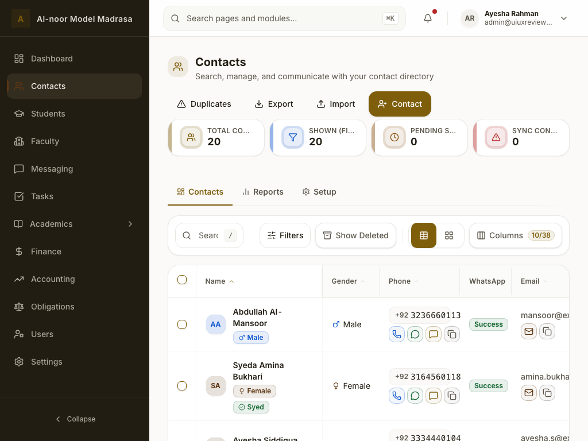

# Shared Work Toolbar Review — 2026-11-05

Focused review of the shared Work-toolbar chain that every tenant directory and the shared
`DataTable` mount, followed by the contained fixes. Baseline `main` HEAD `14334c28a`; the
toolbar files are unchanged since the 2026-11-04 rendered captures
(`git log 30abb1b41..HEAD -- apps/frontend/src/components/app/ModuleWorkToolbar.tsx …` is empty),
so the screenshots below still describe the reviewed state.

No backend, schema, API-contract, or data-flow change. The only product change is the toolbar
cluster itself plus three call sites that were bypassing its contract.

## 0. Provenance

| | |
| --- | --- |
| Baseline | `14334c28a` (`main`), working tree clean before this pass |
| Rendered evidence | [curated 2026-11-04 corpus](./ui-ux-review-2026-11-04/) — Contacts/Students/Faculty/Tasks at 1440, 1024, 375 (en) and 375 (ur) |
| Environment | No dev stack was running, so this pass adds no new browser capture and no axe run |
| Verification | Targeted Vitest (9 files / 74 tests), affected-module batches (561 + 1,187 tests), frontend + root typecheck, frontend lint, `check:code-norms`, `check:shared-ui`, `check:frontend-structure`, `check:work-directory`, `check:i18n`, `check:i18n-unused`, BiDi scan |

## 1. Component map

```
ModuleWorkToolbar (base surface)          ← 4 direct consumers
├── WorkTaskToolbar (composition)         ← 13 consumers (status pills + date range)
│   └── WorkListFiltersScaffold (adapter) ← 2 consumers (chip-based filters)
├── SearchBar (app facade → @shared/ui)
├── WorkViewModeToggle
├── ModuleTrashToggle
├── ModuleClearFiltersButton
└── ModuleColumnCustomizer (+ list popover)
```

### Usage matrix

| Layer | Surfaces |
| --- | --- |
| `ModuleWorkToolbar` | Contacts, Sessions, Accounting → Chart of Accounts, Platform → Activity Logs |
| `WorkTaskToolbar` | Students, Users, Faculty, Attendance, Examinations, Hasanat, Obligations, Question Bank, Messaging, Accounting → Journal Entries, Users → Activity Logs, Accounting → Cashbook, Workshops, Tasks (via `TasksWorkToolbar`), Platform → Admins, Platform → Workspace, `DataTable` (all setup/report tables) |
| `WorkListFiltersScaffold` | Enrollments, Finance → Invoices |

The toolbar therefore reaches **19 tenant surfaces, 3 platform toolbars, and every `DataTable`**;
a defect here is a defect everywhere.

## 2. Scorecard

| Dimension | Grade | Rationale |
| --- | --- | --- |
| Architecture & reuse | **B−** | One visual bar, but three layers with duplicated prop shapes and four unreachable props |
| API honesty | **C+** | Dead density/AI knobs, duplicated trash props, English fallbacks |
| Responsive | **C** | 1024–1279 crushed the search to ~118 px (see below) |
| Accessibility | **B** | Labels/pressed states/live region are right; shortcut was advertised without a handler; landmark labels disagreed |
| i18n | **B+** | Everything goes through `t()` except the trash fallbacks (fixed) and the column-popover reorder strings (backlog) |
| Visual consistency | **B** | Tokens, radii, 44 px targets hold; control drift in Messaging, nested card on `DataTable`, conditional column badge |
| Test coverage | **C** | Base layer had no direct test before this pass |

## 3. What holds up

- 44 px targets (`WORK_TOOLBAR_TRIGGER`), `rounded-xl` controls inside a `rounded-2xl` surface,
  token colours only (no raw hex/arbitrary colours).
- Logical CSS throughout — the BiDi scan is clean (3,974 files, 0 physical direction classes).
- `aria-pressed` on both segmented controls, `role="group"` on the view toggle, a polite
  `role="status"` count, reduced-motion handling in the pill and chips.
- One Filters dropdown per directory (the gold standard), `FilterChips` for active removals.
- Labels are translated by the module; the only hard-coded copy lived in the fallbacks removed
  in this pass.

## 4. Findings

### T-01 · P1 — The search collapses at 1024–1279 px



The region switched to a single row at `lg` (1024) while the actions group kept five controls.
The search — `flex-1 min-w-0` with no minimum — absorbed the whole shortfall: measured at roughly
118 px on both the Contacts and Students 1024 captures, with the `/` hint occupying part of it.

Fix: the row breakpoint moves to `xl` and the search gets `xl:min-w-80`; below 1280 the toolbar
stacks (search on its own row), which is also how it already behaves at 375/768. `xl:gap-7`
preserves the WCAG 2.2 `target-size` clearance the comment documents.

### T-02 · P1 — One `layoutId` for every mounted view toggle

`WorkViewModeToggle` hard-coded `layoutId="workViewModeActivePill"`. Pages routinely mount
several `DataTable`s (Faculty designations/departments, accounting FX panels, …), and every one
renders this toggle, so Framer Motion saw one animating element shared by unrelated toolbars.

Fix: a per-instance id derived from `useId()`; `undefined` when reduced motion is on.

### T-03 · P2 — Two DataTable surfaces bypassed the trash slot

`AcademicCalendarManager` and `CatalogListManager` passed `ModuleTrashToggle` through
`toolbarExtras` (the children slot) instead of `DataTable`'s `trashToggle`. The control rendered
before the filter button instead of after the primary action, and it sat outside the shared
soft-delete contract.

Fix: both now pass `trashToggle`; the toolbar owns position, labels and pressed state.

### T-04 · P2 — Four unreachable props in the public contract

| Prop | State before | Decision |
| --- | --- | --- |
| `densityToggle` | typed and documented, destructured as `_densityToggle`, never rendered | removed |
| `aiSuggestions` | never passed by a consumer; its `aria-label` sat on a generic `div`, where it is ignored | removed, with the two `module.work.aiSuggestions*` keys |
| `WorkTaskToolbar.className` | declared, never read | removed |
| `showExportInTrash` | no production caller, but covered by soft-delete tests | **retained** — it encodes the "children may stay hidden in trash" rule; rename candidate |

### T-05 · P2 — Trash toggle had two APIs and English fallbacks

`ModuleTrashToggle` accepted `showDeleted` **or** `viewingDeleted` and four label props, falling
back to `"Show Active"` / `"Show Trash"`. That is both an i18n hole and API drift.

Fix: `viewingDeleted`, `activeLabel`, `deletedLabel` are now required; the aliases and fallbacks
are gone. All remaining call sites and the soft-delete tests were updated.

### T-06 · P2 — The `/` hint was advertised even where the shortcut was dead

The bar always showed the `/` badge and declared `aria-keyshortcuts="/"`. Two kinds of lie:
seven modules (Attendance, Enrollments, Examinations, Finance, Hasanat, Obligations, Question
Bank) pointed the shortcut at an id that no element renders (`attendance-search-input` vs the
bar's `attendance-work-search`), so `/` did nothing; and seven surfaces (`DataTable`, Platform →
Admins, Platform → Workspace, Platform → Activity Logs, Chart of Accounts, Cashbook, Users →
Activity Logs) had no handler at all.

Fix: the seven controllers now import the bar's search-id constant, so the ids cannot drift;
new `searchShortcutHint` (default `true`) gates the badge + `aria-keyshortcuts` and requires a
`searchId`; `SearchBar` gained `keyshortcuts` (`null` suppresses the attribute). The handler-less
surfaces opt out.

### T-07 · P2 — A card inside a card on every `DataTable`

`DataTable` renders a `WORK_SURFACE` container and the toolbar rendered another one inside it
(border + shadow + padding twice).

Fix: `ModuleWorkToolbar.surface` (`card` | `plain`); `DataTable` passes `plain` and keeps owning
the card. Standalone module toolbars are unchanged.

### T-08 · P2 — Messaging reimplemented the toolbar controls

The archived-log toggle was a bespoke `h-9` button (solid destructive when active) instead of
`ModuleTrashToggle`, and the search id was duplicated as a literal next to the exported constant.

Fix: shared `ModuleTrashToggle` with `messaging.showActiveLogs` / `messaging.showArchived`, the
`MESSAGING_WORK_SEARCH_INPUT_ID` constant, and token-consistent heights on the failed-only pill.

### T-09 · P2 — No direct tests for the base layer

Only `softDeleteUx.test.tsx` touched `ModuleWorkToolbar`. New
`ModuleWorkToolbar.test.tsx` covers the region, search, shortcut hint on/off, count announcer,
slot order, divider conditions, trash label swap + primary-action hiding, `showExportInTrash`,
and the `plain` surface. `WorkViewModeToggle` now pins per-instance layout ids; `SearchBar` pins
the shortcut attribute.

### T-10 · P2 — Three duplicated prop shapes

`trashToggle`, `viewModeToggle` and `columnCustomizer` were declared three times with drifting
optionality. `WorkTaskToolbarProps` now extends `ModuleWorkToolbarProps`; the scaffold picks the
fields it forwards; the base control types live in `moduleWorkToolbarTypes.ts`.

### T-11 · P3 — Landmark labels disagreed

Contacts/Students/Enrollments/Faculty passed `"Filters"` as the region name while other modules
passed the module name. The four now use `nav.*`, so the landmark reads consistently.

### T-12 · P3 — The composition offers a banned pattern (backlog)

`WorkTaskToolbar.statusFilter` renders a permanent status-pill bar below the toolbar, while the
architecture rule makes the single Filters dropdown the owner of status/presets. Only Tasks uses
the slot today; Students keeps a parallel preset bar outside the toolbar. Recorded as backlog
rather than changed here.

### T-13 · P3 — Column-popover reorder copy is English-only (backlog)

`ModuleColumnCustomizerList` builds `${label}: reorder` and an English title hint. Fixing it
needs two keys across en/ar/ur/fa; deferred to avoid landing unreviewed translations.

### T-14 · Decision — the column count badge stays conditional

The badge only renders when something is hidden (`10/38` in Contacts, absent in Tasks at 9/9).
That is intentional feedback for "you hid columns"; the width change is accepted.

## 5. Changes in this pass

| Area | Files |
| --- | --- |
| Base toolbar | `ModuleWorkToolbar.tsx`, `moduleWorkToolbarTypes.ts` |
| Controls | `WorkViewModeToggle.tsx`, `ModuleTrashToggle.tsx`, `packages/ui/src/input/SearchBar.tsx` |
| Compositions | `WorkTaskToolbar.tsx`, `workTaskToolbarTypes.ts`, `WorkListFiltersScaffold.tsx`, `common/work/index.ts` |
| Call sites | `DataTable.tsx`, `PlatformActivityLogsContent.tsx`, Platform admins/workspace toolbars, `MessagingListFilters.tsx`, `AcademicCalendarManager.tsx`, `CatalogListManager.tsx`, `ChartOfAccountsListFilters.tsx`, `CashbookView.tsx`, `ActivityLogsFilters.tsx`, Contacts/Students/Faculty/Enrollments filters |
| Shortcut wiring | Attendance/Enrollments/Examinations/Finance/Hasanat/Obligations/Question-Bank controllers now import the bar's search-id constant |
| Locales | `module.work.aiSuggestionsAria` / `…Description` removed from all four packs |
| Tests | new `ModuleWorkToolbar.test.tsx`, new `packages/ui/src/input/SearchBar.test.tsx`; updated toggle, trash, DataTable, task-toolbar, soft-delete and Contacts tests |

## 6. Verification

| Check | Result |
| --- | --- |
| Targeted toolbar suites (9 files) | **74 passed** |
| Shortcut-id + touched surfaces (215 files) | **676 passed** |
| `components/app`, `components/common/work`, `data-table`, `catalog`, Messaging, Enrollments/Examinations/Invoices filters, soft-delete | **561 passed** (129 files) |
| Attendance, Students, Faculty, Sessions, Contacts, Platform | **1,187 passed** (440 files) |
| `pnpm --filter mms-frontend typecheck` / root `pnpm typecheck` | **Pass** (6/6 tasks) |
| Full frontend suite | **4,304 passed, 2 skipped** (1,157 files) |
| `pnpm --filter mms-frontend lint` / `build` | **Pass** |
| `check:code-norms` · `check:shared-ui` · `check:frontend-structure` · `check:work-directory` | **Pass** |
| `check:i18n` | **Pass** — 9,605 keys, ar/ur/fa complete |
| `check:i18n-unused` | **Pass** — 277 unreferenced vs 517 baseline |
| BiDi scan | **Pass** — 3,974 files, 0 violations |
| `check:docs` | **Pass** after indexing this file |
| Browser / axe | **Not run** — no dev stack in this environment |

## 7. Adversarial audit

- **Edge cases:** no `searchId` or `searchShortcutHint={false}` hides the hint and the
  `aria-keyshortcuts`; empty search shows the hint, typing swaps it for the clear control; trash
  mode swaps labels, hides the primary action and keeps filters/chips; no filters or no layout
  controls removes the divider; an empty registry hides the column customizer; two toggles on a
  page get distinct layout ids; RTL and 375/768 keep the old stacked order.
- **Failure modes:** an omitted trash label is now a compile error rather than English UI; a
  missing translation still falls back to the key (visible, not silent English); reduced motion
  disables the pill animation; the plain surface is opt-in, so existing standalone bars are
  unchanged.
- **Security / multi-tenancy:** none — presentational components, no data access, authorization,
  storage or network change.
- **Concurrency:** rapid view-mode clicks animate only their own instance; the trash callback is
  a boolean setter (double-click converges); search debouncing is owned by consumers and untouched.

## 8. Backlog

1. Sticky toolbar for long directories (the bar scrolls away today).
2. Fold Students/Tasks preset pill bars into the single Filters dropdown, and decide whether
   `statusFilter` should remain (T-12).
3. Localize the column-popover reorder strings (T-13).
4. Make the `/` hint a real, clickable affordance (focus search) instead of decorative `kbd`,
   and wire the shortcut for `DataTable` and the platform toolbars so those surfaces can show it.
5. Always-visible column count, if the conditional badge proves confusing.
6. Mobile tier-card / toolbar surface nesting (visible at 375 as a card in a card).
7. Add a 1024 px case to the responsive E2E sweep (today it covers 375/768/1440, which is why
   T-01 escaped).
8. Rename `showExportInTrash` to a children-slot name if a second consumer appears.

## 9. Residual risks

- The 1024 fix is deterministic CSS but **not browser-verified here**. Manual QA at 1024/1280/
  1440/375 (en + ar) on Contacts, Students, Tasks, Faculty, Platform logs and one `DataTable`
  page remains required before release.
- Removing the dead props assumes no out-of-tree consumer; the workspace grep is clean.
- 1024–1279 now renders a two-row toolbar. If product wants one row there, the alternatives are
  icon-only secondary controls or an overflow menu, both needing design sign-off.
- axe was not re-run; the hint/landmark changes are verified by DOM assertions and code, not a
  browser scan.
