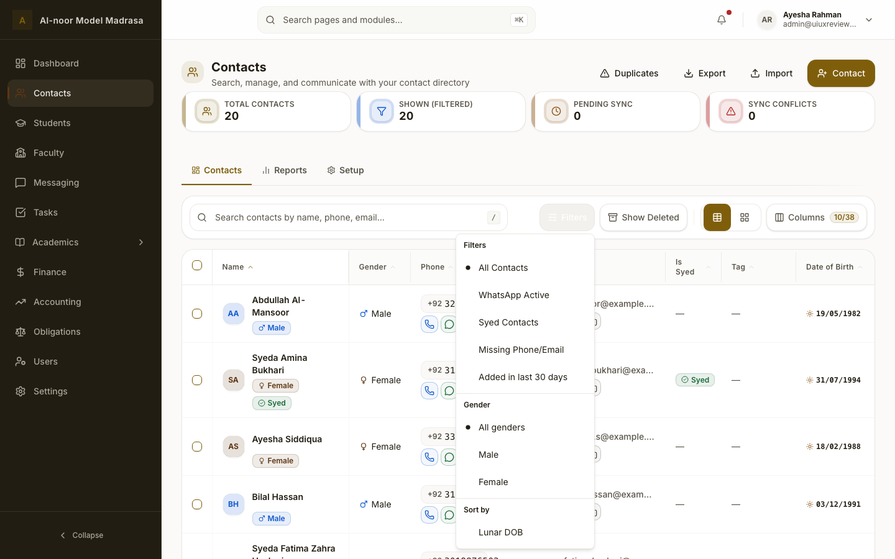
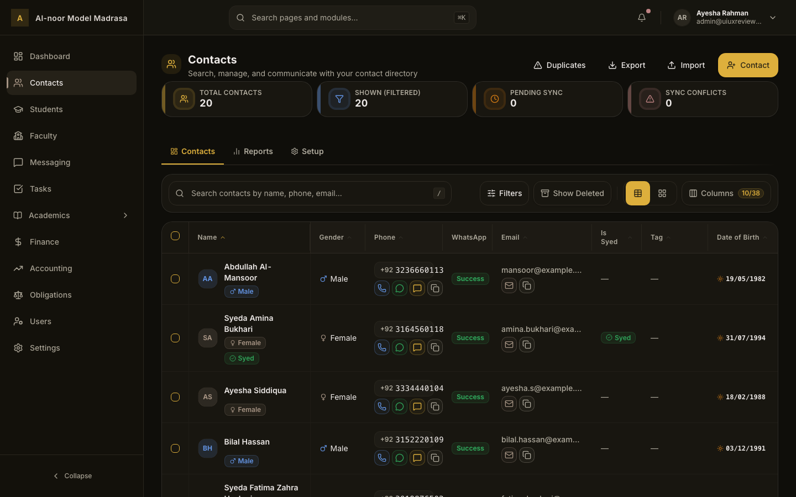
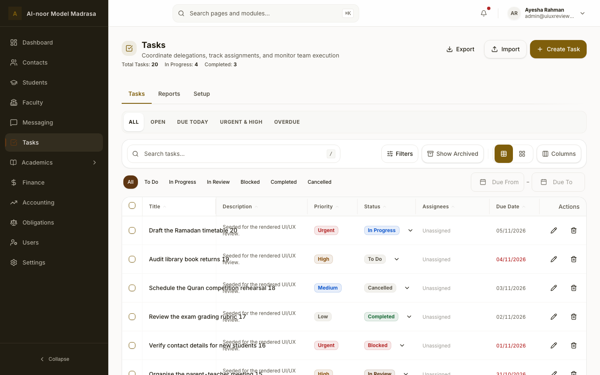
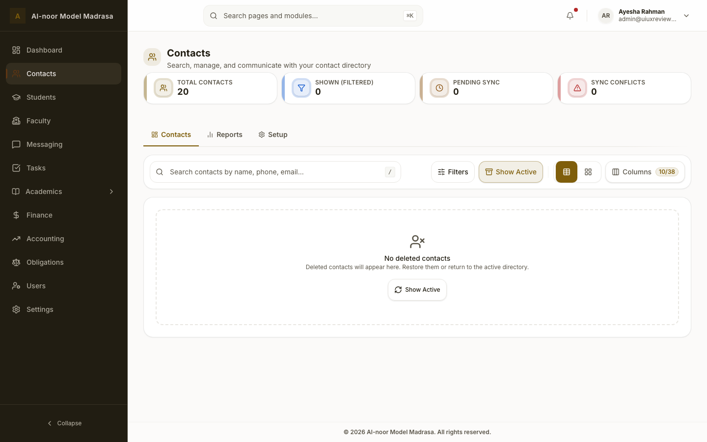
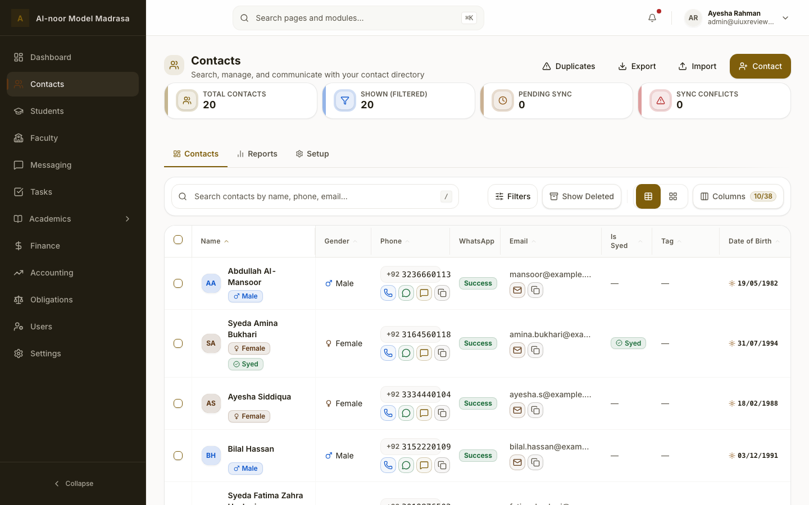
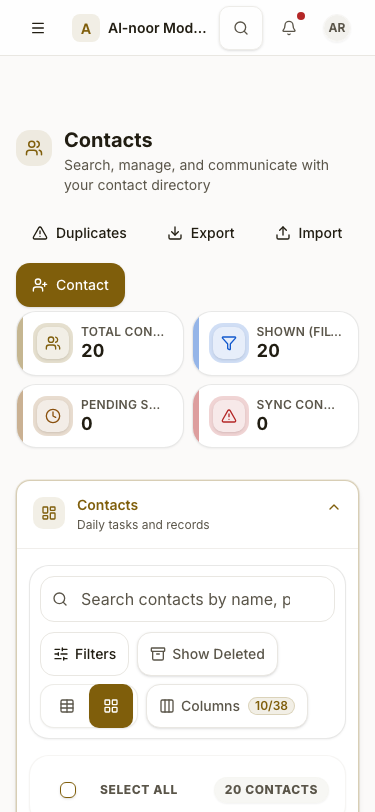

# Shared Work Toolbar — UI/UX Review (2026-11-05)

Design review of the one toolbar chain every tenant directory and the shared `DataTable` mount:
`ModuleWorkToolbar` → `WorkTaskToolbar` / `WorkListFiltersScaffold`, plus its search, Filters
trigger, trash toggle, view toggle and Columns control. This is a **review**, not a change set:
no product code, API, schema or data-flow change is made here. The functional/architecture pass
lives in [shared-work-toolbar-review-2026-11-05.md](./shared-work-toolbar-review-2026-11-05.md).

## 0. Provenance & evidence limits

| | |
| --- | --- |
| Capture baseline | `30abb1b41`, 2026-11-04 rendered corpus (82 screens) |
| Code baseline | `14334c28a` plus the uncommitted functional toolbar pass |
| Screen matrix | 1440 / 1024 / 768 / 375 · light / dark · en / ar / ur / fa · default, filters-open, trash, cards, empty |
| Method | Existing captures + current source + semantic-token and contrast calculations; **no dev stack, no new capture, no axe run** |
| Known deltas | The 1024 search collapse, `DataTable` card-in-card and the dead `/` hint are **fixed in code** but not re-captured; they are marked as resolved below, not counted as open findings |

What changed since the captures: the toolbar now stacks below `xl` instead of crushing the search at
1024; `DataTable` renders the bar with `surface="plain"`; the `/` hint is gated on a real handler.
Everything else in this review (state language, open Filters state, counts, clear target, mobile
nesting, copy) is unchanged by that pass.

## 1. Anatomy & states

```
Toolbar card  ── search field (+ / hint, clear X)
              ── Filters (count badge)  ·  Show Deleted  ·  [table|cards]  ·  Columns (n/m)
              ── filter chips (when active) / status pill + date row (Tasks)
```

Reviewed states: rest, search filled, search loading, Filters active, Filters open, trash mode,
table view, cards view, Columns popover, 1440/1024/768/375, en/ar/ur, light/dark.

## 2. Scorecard

| Dimension | Grade | Rationale |
| --- | --- | --- |
| Visual hierarchy | **B−** | Search dominates correctly, but the solid selected view segment competes with the page CTA (especially in dark mode) |
| Consistency | **C+** | Four “active” languages; two count-badge styles; resting text colour differs; Deleted/Archived terminology |
| Typography | **B** | 14 px controls / 16→14 px search; one clipped placeholder at 375 |
| Colour & theming | **B+** | Token-only, text contrast 6.08:1 light / 6.4:1 dark; active tints pass (5.29:1); the open Filters state is the exception |
| Interaction & feedback | **B−** | Hover/focus/pressed are solid; open Filters looks disabled; trash mode is weakly signalled |
| Affordances | **B−** | Columns count is opaque; icon-only view toggle; clear X is visually small |
| Responsive | **B−** | 1024 fixed in code; 375 is three rows inside a nested card and pushes data below the fold |
| Accessibility | **B−** | 44 px targets, logical CSS, labels/pressed states good; open-trigger contrast + 32 px clear target |
| Copy | **B** | Clear overall; Deleted/Archived drift and a long placeholder |
| **Overall** | **B−** | A well-composed bar with a state-language problem and a mobile-density problem |

## 3. What holds up

- Search is the dominant element; 44 px controls; 12 px card padding and 8 px gaps; consistent
  `rounded-xl` controls inside a `rounded-2xl` surface.
- Token-only colour (no raw hex/arbitrary palette) and logical CSS throughout — RTL mirrors cleanly
  in the 1440-ar and 375-ur captures.
- Focus rings, reduced-motion handling, and non-colour-only state cues (`aria-pressed`, count badge,
  label swap) are all present.
- One Filters dropdown per directory (the architecture gold standard), with chips for active
  removals.

## 4. Findings

### UX-01 · P1 — The open Filters trigger looks disabled



In `contacts-filters-1440-light-en.png` the Filters trigger is nearly invisible while its menu is
open: the label's darkest pixel is `rgb(233,231,226)` versus `rgb(90,84,72)` on the adjacent
“Show Deleted” button, and the button fill turns muted. The 2026-11-04 axe run recorded a serious
`color-contrast` failure on the trigger's label in this state (`#radix… > span`). The source has no
`data-[state=open]` rule for the trigger, so the cause is not proven from code alone.

**Impact:** the primary filter affordance appears disabled exactly when it is active; a WCAG 1.4.3
failure and a misleading affordance.

**Recommendation:** give the trigger an explicit open-state recipe (`data-[state=open]:bg-muted
data-[state=open]:text-foreground`, keep the border) so the state is deterministic, then re-run axe.
Do not rely on hover/focus inheritance.

**Acceptance:** open trigger text ≥ 4.5:1 in light and dark; visually reads as “active”, not disabled;
axe serious/critical = 0 on the open menu.

### UX-02 · P2 — Four different “active” languages



| Element | Active recipe |
| --- | --- |
| Filters trigger | `primary/5` tint + solid primary count badge |
| Show Deleted | `primary/10` tint + label swap |
| View segment | solid `bg-primary` + `primary-foreground` icon |
| Columns | conditional `primary/10` count pill |

**Impact:** the same “selected/toggled” concept has four weights. In dark mode the solid segment is a
bright yellow block — the second strongest element on the page after the page CTA — so a layout
preference outshouts the current mode and the actual primary action.

**Recommendation:** define one state language: toggled controls and the selected segment use the
`primary/10 + primary` tint; one count-badge style; reserve solid primary for page-level CTAs. If the
solid segment is kept deliberately, document it as the only exception and quieten the trash/filter
tints accordingly.

**Acceptance:** at most one solid-primary element in the Work region; Filters/Trash/segment/count
share one documented recipe; dark-mode screenshot shows the CTA as the strongest element.

### UX-03 · P2 — Filter surfaces multiply by module



| Module | Filter chrome |
| --- | --- |
| Contacts | one bar (presets live in the Filters menu) |
| Students | preset card + bar |
| Tasks | preset card + bar + status-pill/date row (≈200 px before the table) |

**Impact:** the same job (narrow the directory) looks different per module; Tasks spends roughly a
fifth of the viewport on filter chrome before any record; users must learn where each module keeps
its presets.

**Recommendation:** one filter surface per directory. Keep presets inside the Filters menu or as
chips; if a module truly needs at-a-glance status counts, use the existing pill row but remove the
parallel preset card. Treat the Contacts pattern as the target and document exceptions.

**Acceptance:** at most one filter surface above the table per directory; presets reachable from the
bar; no module adds a second full-width preset card.

### UX-04 · P2 — Trash mode is cued only by one button



The toolbar changes the button label to “Show Active” and tints it; there is no persistent bar-level
or page-level “Trash view” indicator. In the empty case the empty state reinforces it; with archived
rows present, only the button says so. Tasks keeps its preset and status/date rows visible in trash.

**Impact:** users can misread archived rows as active data, especially after a reload with
`?view=trash` or when returning to a tab.

**Recommendation:** add one persistent, non-colour-only cue at bar level (a warning-toned “Trash
view” chip with the archived count) and announce the mode change (`aria-live`). Keep the toggle;
hide create/communication CTAs as today.

**Acceptance:** a non-empty trash screen has a visible “Trash view” cue outside the toggle; screen
readers announce the mode change; the cue does not appear in active mode.

### UX-05 · P2 — `Columns 6/38` is opaque



The trigger shows “Columns” plus a `visible/total` pill with no explanation, no `title`, and no
description; the popover repeats `(6/38)`. It is also the only count that uses a tinted pill while
the Filters count uses a solid badge.

**Impact:** first-time users cannot tell whether `6/38` means selected columns, hidden columns, or
rows; the two count styles imply two different meanings.

**Recommendation:** keep the visible “Columns” label (label-in-name), add a `title`/description such
as “6 of 38 columns visible”, and use one count-badge recipe across Filters and Columns.

**Acceptance:** hover/focus reveals the meaning; assistive tech reads the count in words; one badge
style across the bar.

### UX-06 · P2 — The search clear control is 32 px


`SearchBar` renders the clear button as `h-8 w-8` with `touch-target-coarse`, which is 24 px on fine
pointers and 44 px only on coarse pointers. Every other toolbar control is 44 px.

**Impact:** the most-used reset affordance is the smallest target; it breaks the repo's 44 px floor
and looks visually under-scaled inside a 44 px field.

**Recommendation:** make the clear button 44×44 (keep the 14 px icon and adjust the input's end
padding) so the visible and hit areas agree.

**Acceptance:** computed hit area ≥ 44×44 on pointer and touch; no text overlap; axe target-size
clean.

### UX-07 · P2 — At 375 the bar is three rows inside a nested card



On phones the tier accordion already draws a bordered card; the toolbar draws a second one inside it,
then wraps into three rows (search / Filters + Show Deleted / view toggle + Columns). The first data
row sits below the fold of an 812 px viewport.

**Impact:** double framing and ≈180 px of toolbar chrome on the smallest screen; the directory looks
empty until the user scrolls. The page header and KPI cards also contribute, but the toolbar is the
part this component owns.

**Recommendation:** render the bar flat inside the mobile tier (`surface="plain"` via a tier-surface
context), and target two rows at 375 — for example keep Filters + Show Deleted + the view toggle on
one line and move Columns to an icon-only trigger, or collapse the layout controls into one group.

**Acceptance:** one surface boundary inside the mobile tier; at most two toolbar rows at 375; first
record visible sooner; no control clipped.

### UX-08 · P3 — The bar scrolls away

The toolbar is not sticky. With a long directory the search and filters leave the viewport while the
table header stays pinned.

**Recommendation:** desktop-only sticky bar under the page header with `scroll-padding-top`; consider
a compact sticky variant after scroll on mobile.

**Acceptance:** search reachable after scrolling three screens at 1440/1024; no overlap with the
sticky table header; focused controls are not obscured (WCAG 2.2 2.4.11).

### UX-09 · P3 — Resting text colours disagree

Filters uses `WORK_TOOLBAR_TRIGGER_FILTER_IDLE` (`text-foreground`); Show Deleted and Columns use
`WORK_TOOLBAR_TRIGGER_IDLE` (`text-muted-foreground`). In the capture “Filters” is visibly darker than
its neighbours.

**Impact:** an accidental hierarchy; the bar looks slightly uneven at rest.

**Recommendation:** one resting colour for all triggers, with active state (not resting weight) as
the differentiator. If Filters is intentionally primary, express it with weight/placement and
document it.

**Acceptance:** all idle triggers share one text colour; the active state remains the only emphasis.

### UX-10 · P3 — Deleted vs Archived vs Trash

Module labels disagree: “Show Deleted” (Contacts, Students, Faculty, Users), “Show Archived” (Tasks),
“Archived logs” (Messaging). The shared component takes the label from each module, so this is a
product vocabulary decision.

**Recommendation:** pick one term per entity semantics (records deleted/restored vs logs archived)
and apply it across locales; document the exception if a domain genuinely differs.

**Acceptance:** a single term in the four locales per domain; no module mixes “Trash”/“Archived” in
the same surface.

### UX-11 · P3 — Long placeholder clips at 375


“Search contacts by name, phone, email…” renders as “Search contacts by name, p” at 375.

**Recommendation:** shorten the placeholder (“Search contacts…”) or add a short mobile variant; if
truncation is unavoidable, make it a deliberate ellipsis rather than a mid-word cut.

**Acceptance:** placeholder readable at 375 in en/ar/ur/fa; no mid-word clipping.

### UX-12 · P3 — Icon-only view toggle relies on convention

The table/cards toggle is two icon buttons; its labels exist only as `title`/`aria-label`, and touch
users get no hover tooltip.

**Recommendation:** keep the conventional icons, but consider a short visible label at `sm+` or a
one-time hint; at minimum verify the icons are distinguishable at 16 px in both themes.

**Acceptance:** first-time users can name both modes without hovering; icons remain legible at 16 px.

## 5. Proposed design contract

| Concern | Contract |
| --- | --- |
| Hierarchy | Page CTA is the only solid-primary element in the Work region; search is the largest; filters are tonal; layout controls are the quietest |
| Toggled state | `border-primary/30 bg-primary/10 text-primary` for Filters/Trash; the view segment uses the same tonal recipe (no solid fill) |
| Counts | One badge recipe (`bg-primary/15 text-primary`) with a descriptive `title`/description; the numeric text stays inside the accessible name |
| Trash | Persistent “Trash view” chip + archived count; primary/communication actions hidden; mode change announced |
| Surfaces | One filter surface above the table; flat bar inside the mobile tier |
| Density | 44 px targets (including clear); one row ≥ 1280, two rows 768–1279, two rows at 375 |
| Copy | One deleted/archived vocabulary per domain; short placeholders |
| Sticky | Desktop sticky with `scroll-padding-top`; optional compact mobile variant |

## 6. Prioritised backlog

| Pri | Item | Effort | Risk / dependency |
| --- | --- | --- | --- |
| P1 | UX-01 open Filters trigger contrast/state | S | Needs browser + axe verification |
| P2 | UX-02 unify active/count language | M | Design sign-off; affects every module |
| P2 | UX-03 one filter surface (Tasks/Students) | M–L | Module owners; architecture decision |
| P2 | UX-04 trash-mode cue | S–M | Copy + i18n keys; product sign-off |
| P2 | UX-05 Columns count description + one badge style | S | None |
| P2 | UX-06 44 px clear target | S | Shared `SearchBar`; visual check |
| P2 | UX-07 flat mobile bar + two rows | M | Tier-surface context; browser QA |
| P3 | UX-08 sticky bar | M | Browser/perf QA |
| P3 | UX-09 resting text colour | S | Design sign-off |
| P3 | UX-10 terminology | S | Product copy decision |
| P3 | UX-11 mobile placeholder | S | Module copy |
| P3 | UX-12 icon-only toggle | S | Optional labels |

## 7. Open decisions

1. Trash cue: chip in the bar vs banner above the table vs tinted bar?
2. View segment: tonal selected state vs keep the solid fill as a documented exception?
3. Sticky: desktop only, or a compact sticky bar on mobile too?
4. Vocabulary: “Deleted/Trash” or “Archived” per entity type?
5. Are the Students/Tasks preset bars product-required, or can they move into the Filters menu?

## 8. Evidence gaps & residual risks

- No post-fix capture: the 1024 stack, `DataTable` plain surface and shortcut hint are verified in
  code/tests but not visually. Re-capture at 1440/1280/1024/768/375 in en/ar, light/dark before
  closing UX-07/UX-08 and the 1024 delta.
- UX-01's root cause is not proven from source; the recommendation is a defensive open-state recipe
  plus a browser recheck, not a confirmed fix.
- axe was not re-run; the open-trigger contrast comes from the 2026-11-04 manifest.
- Grades and recommendations are a design opinion; several need product/design sign-off before
  implementation.

## Appendix A — Contrast spot checks

| Pair | Light | Dark |
| --- | --- | --- |
| `muted-foreground` on `card` | 6.08:1 | 6.40:1 |
| `primary` on `primary/10` | 5.29:1 | 7.21:1 |
| `primary-foreground` on `primary` | 6.08:1 | 8.73:1 |
| `border` on `card` (non-text) | 1.30:1 | 1.26:1 |

Text pairs pass AA; the 1.3:1 border is decorative (the surface and label identify the controls).

## Appendix B — Additional captures

- **1024 (pre-fix)** — [contacts-1024-light-en.png](./shared-work-toolbar-ui-ux-review-2026-11-05/screenshots/contacts-1024-light-en.png):
  the search crushed to ≈118 px; fixed in code, pending a post-fix re-capture.
- **768** — [contacts-768-light-en.png](./shared-work-toolbar-ui-ux-review-2026-11-05/screenshots/contacts-768-light-en.png):
  two rows, right-aligned actions, nested tier/toolbar surfaces.
- **RTL wide** — [contacts-1440-light-ar.png](./shared-work-toolbar-ui-ux-review-2026-11-05/screenshots/contacts-1440-light-ar.png):
  mirrored order, search on the right, count badge mirrored.
- **RTL mobile** — [contacts-375-light-ur.png](./shared-work-toolbar-ui-ux-review-2026-11-05/screenshots/contacts-375-light-ur.png):
  three rows in RTL; no clipping of the controls.
- **Cards view** — [contacts-cards-375-light-en.png](./shared-work-toolbar-ui-ux-review-2026-11-05/screenshots/contacts-cards-375-light-en.png):
  the selected segment moves to cards; the mobile layout is unchanged.
- **Students** — [students-1440-light-en.png](./shared-work-toolbar-ui-ux-review-2026-11-05/screenshots/students-1440-light-en.png):
  preset card above the bar — the second filter surface called out in UX-03.
- **Tasks trash** — [tasks-trash-1440-light-en.png](./shared-work-toolbar-ui-ux-review-2026-11-05/screenshots/tasks-trash-1440-light-en.png):
  trash mode with preset and status/date rows still visible; no bar-level mode cue.

## Appendix C — Capture inventory

`contacts-1440-light-en`, `contacts-1024-light-en` (pre-fix), `contacts-768-light-en`,
`contacts-375-light-en`, `contacts-375-light-ur`, `contacts-1440-light-ar`,
`contacts-1440-dark-en`, `contacts-filters-1440-light-en`, `contacts-trash-1440-light-en`,
`contacts-cards-375-light-en`, `students-1440-light-en`, `tasks-1440-light-en`,
`tasks-trash-1440-light-en`. Source: `.logs/ui-ux-review-2026-11-04/screens/` (gitignored; copied
into `screenshots/` so the links run in a clean checkout).
