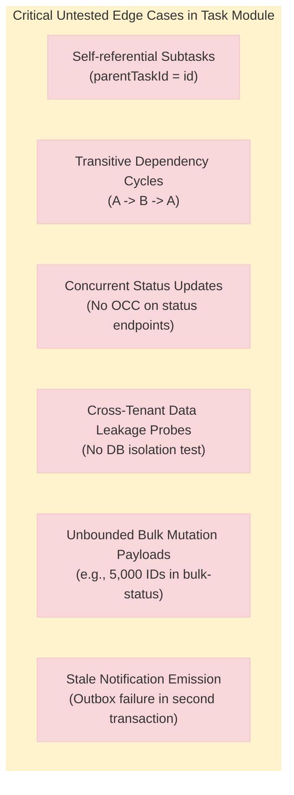
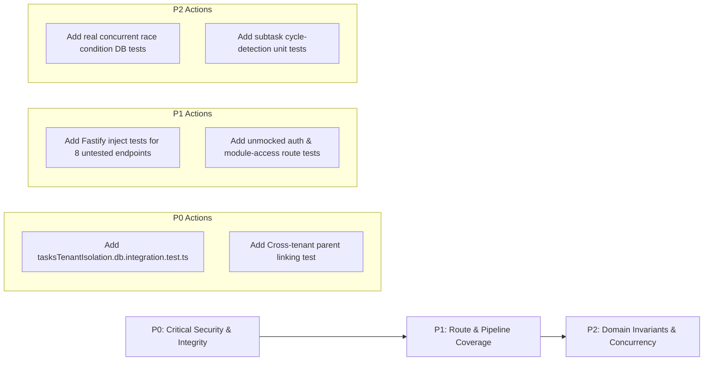

# Task Module — Test Suite Evaluation

> **Scope**: Audit of unit tests, database integration suites, and Fastify route inject suites for the Task module across backend, shared contracts, and frontend layers.  
> **Audited Repository**: `mms` · **Date**: 2026-11-12 · **Status**: Completed

---

## Table of Contents

1. [Executive Summary & Test Inventory](#1-executive-summary--test-inventory)
2. [Domain & Recurrence Tests Evaluation](#2-domain--recurrence-tests-evaluation)
3. [Concurrency, Reorder & OCC Tests Evaluation](#3-concurrency-reorder--occ-tests-evaluation)
4. [Tenant & Visibility Security Tests Evaluation](#4-tenant--visibility-security-tests-evaluation)
5. [Route Integration (Fastify.inject) Evaluation](#5-route-integration-fastifyinject-evaluation)
6. [Gap Analysis: Untested Edge Cases & Flaky Patterns](#6-gap-analysis-untested-edge-cases--flaky-patterns)
7. [Prioritized Remediation Roadmap](#7-prioritized-remediation-roadmap)

---

## 1. Executive Summary & Test Inventory

The Task module test suite spans three workspaces (`@mms/shared`, `mms-backend`, and `mms-frontend`), encompassing **38 test files** and **144 total tests**:

| Test Layer | Test Files | Total Tests | Pass Rate | Execution Time | Real DB Usage |
|---|---|---|---|---|---|
| **Shared Contracts & Invariants** (`@mms/shared`) | 2 | 9 | 100% | ~1.1s | None (Pure TS) |
| **Backend Unit & Adapter Tests** | 8 | 25 | 100% | ~0.1s | None (Mocks) |
| **Backend Route Inject Tests** (`fastify.inject`) | 3 | 20 | 100% | ~2.7s | None (Mocked Services) |
| **Backend Background & Import/Export** | 2 | 5 | 100% | ~0.1s | None (Mocks) |
| **Backend Real DB Integration** | 2 | 7 | 100% | ~4.2s | Real PostgreSQL |
| **Frontend Unit & Component Suites** | 23 | 85 | 100% | ~15.1s | Vitest / jsdom |
| **Total** | **40** | **151** | **100%** | **~23.2s** | **2 DB Suites** |

### Verified Test Files Inventory

```
packages/shared/src/obligations/
├── tasksSecurity.test.ts                         (6 tests: capability boundaries, schema strictness)
└── tasksStatusTransitions.test.ts                (3 tests: valid/invalid status graph edges)

apps/backend/src/__tests__/
├── tasksUseCases.test.ts                         (3 tests: mock delegation to repository)
├── tasksRepository.test.ts                       (1 test: interface conformity check)
├── tasksRepositoryAdapter.test.ts                (2 tests: adapter method delegations)
├── tasksBulkRepository.test.ts                   (4 tests: batch delete/restore/status, skip reasons)
├── taskDelegationService.test.ts                 (8 tests: recipient authorization & hierarchy)
├── taskPermissionService.test.ts                 (3 tests: RBAC check resolutions)
├── taskNotificationService.test.ts               (3 tests: outbox event emission intents)
├── tasksExportService.test.ts                    (3 tests: pagination, streaming, directory filters)
├── tasksImportUseCases.test.ts                   (2 tests: CSV import parsing & permission check)
├── backgroundJobTasksRunners.test.ts             (1 test: runner registration)
├── tasksAssign.integration.test.ts               (9 inject tests: assign/assign_anywhere route gates)
├── tasksTrashAccess.integration.test.ts          (6 inject tests: trash list gating & includeDeleted)
├── tasksSoftDeleteErrors.integration.test.ts      (5 inject tests: archive/restore HTTP error taxonomy)
└── db-integration/
    ├── taskDelegationScopeDb.integration.test.ts (5 DB tests: hierarchy subtree & self-assign)
    └── occWritesDb.integration.test.ts           (2 DB tests for tasks: OCC stale token vs fresh)
```

---

## 2. Domain & Recurrence Tests Evaluation

### 2.1 Circular Dependency Rejection

> [!CAUTION]
> **Critical Testing Gap**: There are **zero unit tests** covering circular dependency detection or rejection.

- **Current State**: `tasksUseCases.test.ts` only asserts that the use-case wrapper delegates arguments to the injected `TasksRepository` mock. No domain logic or invariants are validated.
- **Architectural Reality**: In `tasksWriteRepository.ts` and `taskMutationService.ts`, subtasks are represented by a single self-referencing column `parentTaskId`. There is **no cycle-detection algorithm** (e.g., checking if task A is set as parent of task B while task B is already an ancestor of task A, or self-parenting `task.id === task.parentTaskId`).
- **Missing Tests**:
  - Direct self-parenting test: setting `parentTaskId = id`.
  - Transitive cycle test: `Task A (parent: B) -> Task B (parent: C) -> Task C (parent: A)`.
  - Max nesting depth limit test (preventing unbounded recursive subtask trees).

### 2.2 Subtask Completion Rules

- **What Is Covered**:
  - `tasksBulkRepository.test.ts` (lines 70–81) verifies that `bulkDeleteTasksBatch` skips parent tasks that have active children (`reason: "has_active_children"`).
  - `tasksBulkRepository.test.ts` (lines 83–95) verifies that `bulkRestoreTasksBatch` skips subtasks whose parent remains archived (`reason: "parent_archived"`).
  - `tasksSoftDeleteErrors.integration.test.ts` (lines 69–83) asserts that deleting a task with active subtasks maps to HTTP 409 Conflict.
- **What Is NOT Covered**:
  - **Parent Completion Invariant**: No test checks whether marking a parent task `completed` is blocked if child subtasks are still `todo`, `in_progress`, or `blocked`.
  - **Cascading State Transitions**: No test checks whether completing all subtasks triggers an auto-completion or review notification for the parent.
  - **Subtask Status Synchronization**: No test verifies that changing a parent task to `cancelled` cascades cancellation down to its active subtasks.

### 2.3 Recurring Task Date Calculations

> [!WARNING]
> **Subsystem Absence & Zero Tests**: The Task module possesses **zero recurrence engine tests**.

- **Root Cause**: The Task module currently does not implement a recurring task engine (`recurrenceRule`, `rrule`, or cron schedule).
- **Date Test Reality**:
  - `taskFormPayload.test.ts` (lines 32–47) only asserts that `dueAt` cannot precede `startDate` (`tasks.dueBeforeStart`).
  - `tasksServerFilters.test.ts` (lines 45–54, 76–91) asserts that "due today" calculates local calendar day bounds using `vi.useFakeTimers()` set to `2026-11-04`.
  - **Gaps**: There are no tests for month-end boundary calculations (e.g. recurring on the 31st of every month handling February or 30-day months), leap year dates (Feb 29), or daylight saving time (DST) shifts across timezones.

---

## 3. Concurrency, Reorder & OCC Tests Evaluation

### 3.1 Optimistic Concurrency Control (OCC) Tests

OCC testing is confined to `occWritesDb.integration.test.ts`:

```ts
// occWritesDb.integration.test.ts
describe("Tasks optimistic concurrency", () => {
  it("rejects a stale token with a 409 conflict and leaves the row unchanged", async () => {
    const stale = new Date(Date.now() - 60_000).toISOString();
    await expect(
      updateTask(TENANT, "t-occ", { title: "stale title" }, undefined, ADMIN.id, stale),
    ).rejects.toBeInstanceOf(ConflictError);
    // ...asserts row title remains 'Original title'
  });

  it("accepts the token the client read", async () => {
    const token = await taskUpdatedAt();
    const updated = await updateTask(TENANT, "t-occ", { title: "Fresh title" }, undefined, ADMIN.id, token);
    expect(updated?.title).toBe("Fresh title");
  });
});
```

#### Evaluation & Gaps:
1. **Synthetic vs. Real Race Conditions**: The test artificially crafts a synthetic timestamp string (`Date.now() - 60_000`) rather than spawning two simultaneous, competing asynchronous worker transactions (e.g. `await Promise.all([workerA(), workerB()])`).
2. **Missing Status Transition OCC**: OCC is only tested on general title updates via `updateTask`. `updateTaskStatus` and `bulkUpdateTaskStatusBatch` in `tasksWriteRepository.ts` and `tasksBulkRepository.ts` **do not accept an OCC token**; simultaneous status transitions can overwrite each other without detection.
3. **Missing Route-Level OCC Tests**: No Fastify route integration test passes an outdated `x-expected-updated-at` header to assert that `PATCH /api/tasks/:id` returns a standardized `409 Conflict` payload over HTTP.

### 3.2 Kanban Reordering & Fractional Indexing

> [!NOTE]
> **Feature Non-Existent in Backend**: Neither fractional indexing (LexoRank / midpoint floats) nor manual Kanban drag-and-drop column positioning exists in the persistence schema or repository layer.

- The `tasks` database table has **no `sortOrder` or `rank` column**.
- Consequently, there are **no integration tests** simulating concurrent drag-and-drop reorders, rank collisions, midpoint precision exhaustion, or rebalancing algorithms.

---

## 4. Tenant & Visibility Security Tests Evaluation

### 4.1 Cross-Tenant Isolation Tests

| Isolation Vector | Covered in Test Suite? | Evidence / File |
|---|---|---|
| Cross-tenant task read (`findTaskById`, `listTasks`) | ❌ **UNTESTED** | No test runs Tenant A query against Tenant B row |
| Cross-tenant task mutation (`updateTask`, `deleteTask`) | ❌ **UNTESTED** | No test attempts cross-tenant ID update |
| Cross-tenant parent linking (`parentTaskId`) | ❌ **UNTESTED** | No test attempts linking to foreign tenant task ID |
| Cross-tenant assignee injection (`facultyId`, `userId`) | ⚠️ **PARTIAL** | `taskDelegationService.test.ts` rejects ineligible IDs, but in-memory mock only |
| Cross-tenant RLS under non-bypass role | ❌ **UNTESTED FOR TASKS** | `rlsEnforcement.db.integration.test.ts` tests documents & students, NOT tasks |
| Parameterized query tenant injection | ⚠️ **UNIT ONLY** | `tasksSecurity.test.ts` checks schema rejects `workspaceSubdomain` |

> [!CAUTION]
> **Major Integration Test Blindspot**: Unlike Attendance (`attendanceTenantIsolation.db.integration.test.ts`), Examinations (`examinationsTenantIsolation.db.integration.test.ts`), and Hasanat (`hasanatTenantIsolation.db.integration.test.ts`), there is **NO `tasksTenantIsolation.db.integration.test.ts`**.
>
> Although the PostgreSQL RLS policy and composite PK `(workspace_subdomain, id)` structurally defend against cross-tenant access, there is no automated test asserting that an attacker in Workspace A cannot read or mutate Task B by guessing its UUID.

### 4.2 Visibility & Private Tasks Security Tests

- **Domain Model Reality**: Tasks in MMS do not possess a `visibility` column (`private` vs `team` vs `public`). Every task belonging to a tenant is visible to any authenticated user with `tasks.read` permission.
- **Test Reality**:
  - `tasksTrashAccess.integration.test.ts` verifies that normal readers cannot access archived/deleted tasks without `tasks.delete` permission (lines 90–107).
  - `taskPermissionService.test.ts` verifies role-based action gating (`tasks.assign_anywhere` vs `tasks.assign`).
  - **Gap**: There are no tests asserting row-level visibility constraints (e.g., user X cannot see tasks created by user Y) because no row-level privacy boundaries are defined in the schema.

---

## 5. Route Integration (Fastify.inject) Evaluation

The Fastify route integration suite for tasks consists of three files:
1. `tasksAssign.integration.test.ts` (9 tests)
2. `tasksTrashAccess.integration.test.ts` (6 tests)
3. `tasksSoftDeleteErrors.integration.test.ts` (5 tests)

### 5.1 Endpoint Coverage Matrix

| Endpoint | Method | Tested in Route Suite? | Assertions / Scenarios Tested |
|---|---|---|---|
| `/api/tasks` | `GET` | ✅ Covered | `dueFrom`/`dueTo` parsing, active list access |
| `/api/tasks?includeDeleted=true` | `GET` | ✅ Covered | Gated by `tasks.delete` (403 for read-only, 200 for delete) |
| `/api/tasks/metrics` | `GET` | ❌ **MISSING** | **Untested** via Fastify inject |
| `/api/tasks/eligible-assignees` | `GET` | ❌ **MISSING** | **Untested** via Fastify inject |
| `/api/tasks/settings` | `GET` | ❌ **MISSING** | **Untested** via Fastify inject |
| `/api/tasks/settings` | `PUT` | ❌ **MISSING** | **Untested** via Fastify inject (`settings.global.write` gate) |
| `/api/tasks/:id` | `GET` | ❌ **MISSING** | **Untested** via Fastify inject (200 retrieval, 404 not found) |
| `/api/tasks` | `POST` | ✅ Covered | Denies without `tasks.assign` (403), allows with permission (201), passes `assign_anywhere` |
| `/api/tasks/:id` | `PATCH` | ✅ Covered | Denies assignees without `tasks.assign` (403) |
| `/api/tasks/:id/status` | `PATCH` | ✅ Covered | Maps illegal transition to 400 |
| `/api/tasks/bulk-status` | `POST` | ✅ Covered | Denies without write/complete (403), allows complete-only (200), rejects empty IDs (400) |
| `/api/tasks/:id` | `DELETE` | ✅ Covered | 200 on archive, 409 on subtask conflict, 500 on unexpected failure |
| `/api/tasks/:id/restore` | `POST` | ✅ Covered | 409 on missing parent, 400 on invalid payload |
| `/api/tasks/bulk-delete` | `POST` | ❌ **MISSING** | **Untested** via Fastify inject |
| `/api/tasks/bulk-restore` | `POST` | ❌ **MISSING** | **Untested** via Fastify inject |
| `/api/tasks/export` | `POST` | ❌ **MISSING** | **Untested** via Fastify inject |
| `/api/tasks/import` | `POST` | ❌ **MISSING** | **Untested** via Fastify inject |

### 5.2 Heavy Mocking Anti-Pattern in Route Tests

> [!WARNING]
> **Mock Isolation Anti-Pattern**: All three Fastify route test files construct test applications using `vi.mock` on the entire security and persistence stack:
> - `authenticateTenant` is mocked to `async () => {}`
> - `registerModuleAccess` is mocked to `vi.fn()`
> - `canPerformTaskAction` is mocked to return static booleans
> - `mutateTask`, `updateTaskStatus`, `deleteTask` are mocked
>
> **Implications**: The route test suite tests **route handler routing and input validation only**. It **does not test**:
> 1. Real JWT authentication or token expiry.
> 2. Real module licensing enforcement via `registerModuleAccess`.
> 3. Real database transactions or transaction rollbacks.
> 4. Real error serialization from Drizzle ORM errors.

---

## 6. Gap Analysis: Untested Edge Cases & Flaky Patterns

### 6.1 Critical Untested Edge Cases



1. **Cycle Prevention in Parent-Child Links**: Neither unit tests nor database integration tests attempt to insert or update a task with a cycle (`A -> B -> A` or `A -> A`).
2. **Bulk Payload Sizing & DoS Boundaries**: While `tasksBulkStatusBodySchema` rejects empty arrays `ids: []`, there are no tests verifying behavior when a payload contains 1,000+ IDs (payload size limits, query execution timeout).
3. **OCC in Status Transitions**: `PATCH /api/tasks/:id/status` does not assert OCC behavior with `x-expected-updated-at`. If two users simultaneously drag or advance the same task, the last write silently wins.
4. **Advisory Lock Deadlock Tests**: `lockFacultyHierarchy` is called twice during mutations (once in `mutateTask` and once inside `createTask`/`updateTask`). No tests verify concurrent lock acquisition under high load to check for PostgreSQL advisory lock deadlocks.

### 6.2 Flakiness & Assertion Fragility

1. **Timestamp Representation Mismatch in OCC**: In `occWritesDb.integration.test.ts`, the test relies on:
   ```ts
   const token = await taskUpdatedAt(); // uses Date.toISOString()
   ```
   If PostgreSQL's microsecond precision (`timestamptz(6)`) does not match the ISO-8601 formatting in JavaScript (`toISOString()` truncates or rounds to 3 decimal places `.sssZ`), timestamp comparisons can flake across different database environments.
2. **Unvalidated Mock Response Structures**: In `tasksTrashAccess.integration.test.ts` and `tasksSoftDeleteErrors.integration.test.ts`, mock return values bypass TypeBox/Zod runtime schemas. If repository schemas change, the tests will continue to pass while the live API breaks.

---

## 7. Prioritized Remediation Roadmap



### Remediation Schedule

| Priority | Task | Target File(s) | Impact |
|---|---|---|---|
| **P0** | **Create Dedicated DB Tenant Isolation Suite**<br/>Assert that Tenant A cannot read, query, update, delete, or link parent tasks belonging to Tenant B under real PostgreSQL RLS. | `src/__tests__/db-integration/tasksTenantIsolation.db.integration.test.ts` | Prevents regression of tenant boundary guarantees. |
| **P0** | **Enforce & Test Status Transition OCC**<br/>Add `expectedUpdatedAt` token checking to `updateTaskStatus` and add integration tests verifying simultaneous status conflicts return 409. | `src/__tests__/db-integration/occWritesDb.integration.test.ts` | Eliminates lost-update races during simultaneous status changes. |
| **P1** | **Complete Fastify Route Inject Coverage**<br/>Implement inject tests for `/api/tasks/metrics`, `/api/tasks/eligible-assignees`, `/api/tasks/settings` (GET/PUT), `/api/tasks/:id` (GET), and bulk soft-delete/restore endpoints. | `src/__tests__/tasksRoutes.integration.test.ts` | Closes the 8 untested route handler gaps. |
| **P1** | **Add Subtask Circular Reference Rejection Tests**<br/>Introduce unit and repository tests asserting that self-referencing (`id === parentTaskId`) and circular graphs (`A -> B -> A`) throw `ValidationError`. | `src/__tests__/tasksUseCases.test.ts` | Protects tree navigation algorithms from infinite call stack overflows. |
| **P2** | **Simulate Real Parallel Concurrency in DB Suites**<br/>Replace synthetic timestamp OCC tests with `Promise.all()` parallel requests racing against the same task record to verify database locking behavior. | `src/__tests__/db-integration/tasksConcurrencyDb.integration.test.ts` | Validates transaction serialization and lock safety under load. |
| **P2** | **Test Bulk Boundary Limits**<br/>Add tests asserting maximum array length validation (e.g., rejecting > 500 items in `bulk-status`, `bulk-delete`) and pagination boundary parameters. | `src/__tests__/tasksBulkRepository.test.ts` | Shields the application from resource exhaustion and query timeouts. |
