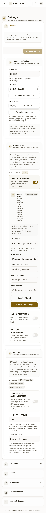
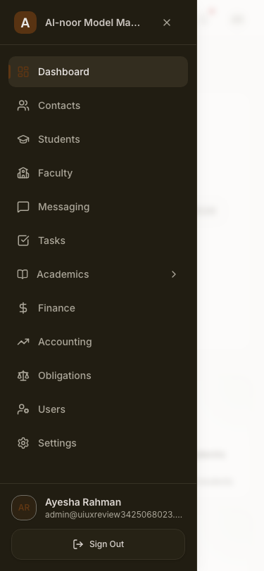
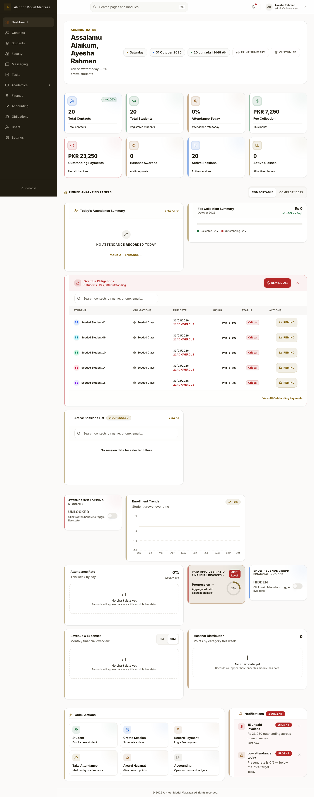
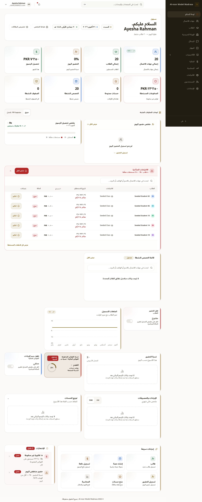
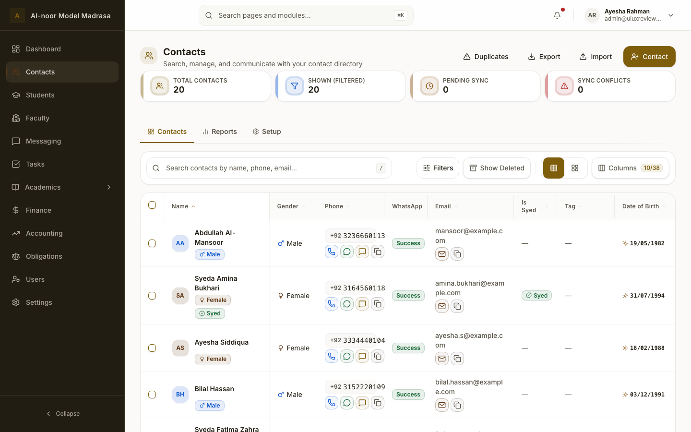
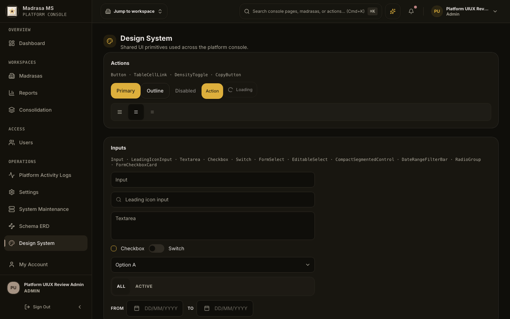
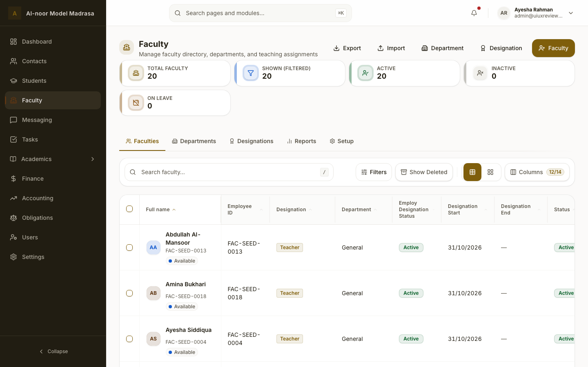

# UI/UX Review — MMS (2026-10-31)

**Status:** review complete. No product code, API, schema, or configuration changes were made
during the review itself. Review-harness changes are included so the corpus is reproducible (see
[§8](#8-verification-and-reproducibility)).

> **Post-review status (2026-10-31):** every actionable finding was implemented and re-measured;
> see [RESOLUTION.md](./RESOLUTION.md) for the evidence and §4 there for the explicitly deferred
> remainders (mobile card density, ar/ur chunk splitting, dashboard composition). The findings
> below are kept as the original review record.

This is a fresh rendered-browser and code review at `a7f22cfb5`, one day after the previous
review ([`../ui-ux-review-2026-10-30/`](../ui-ux-review-2026-10-30/README.md)) was fully
resolved. It re-checks every one of those 20 findings and hunts for regressions and new UX debt
against the 175 frontend files that changed since `54d2eaef0`.

| | |
|---|---|
| Snapshot | `a7f22cfb5` (`main`, 2026-10-31 06:33 PKT); review ran against a clean tree (no uncommitted product changes). |
| Environment | local Vite (`:5173`) + Fastify (`:3000`) + Docker Postgres/Redis; Chromium via Playwright 1.64 (headless); **dev server**, not a production build |
| Fixture | synthetic `uiuxreview3425068023` tenant: 20 contacts, 20 students, 20 sessions, 20 faculty, 20 invoices; institution profile completed during the run |
| Corpus | **115 manifest entries** across **43 unique surfaces**, plus first-run setup and probe captures. 1440/1024/375 × light/dark × en/ar/ur/fa |
| Prior review | all 20 findings re-classified: **16 HOLDS**, **4 PARTIAL/REGRESSED** (none re-opened at P0) |

---

## 1. Executive summary

The 2026-10-30 fixes held. Arabic/Persian dates render correctly, the contacts `Name` column
is healthy, language survives a brand-new browser, the platform axe gate and mobile header are
green, mobile modules open at the top, and the 12 px type floor and token contrast contract are
executable and passing. The structural quality that made the previous review grade the
architecture A− is still there: zero horizontal overflow in 115 captures, zero physical-direction
classes across 3,792 files, 9,410 translation keys with zero missing across ar/ur/fa, and shared
table/form/drawer primitives used consistently.

The remaining problems are **not architectural**. They are concentrated in four places:

1. **One mobile layout break that makes a core settings flow unreadable** — the email/SMS/WhatsApp
   integration headers collapse the title column to **58 px** at 375 px, so setup instructions
   render one word per line and provider fields clip (P1).
2. **Two live WCAG AA contrast failures** the existing axes do not reach: the mobile sidebar
   member initials at **1.49:1**, and the platform Design System subtitle at **4.41:1** (P1/P2).
3. **Data-display polish that undermines trust in numbers** — the same screen shows `PKR 7,250`
   and `Rs 0` (and `Rs 0.00` elsewhere), Arabic/Persian dashboards use Latin digits for counts
   while dates use Arabic-Indic, and emails wrap mid-token in directory tables (P2).
4. **Interaction discoverability** — row actions are `opacity-0` until hover, so every Actions
   column is visually empty at rest, and sortable headers are 16 px tall click targets (P2).

### Scorecard

| Dimension | Grade | Rationale |
|---|---|---|
| Visual hierarchy & composition | **C+** | Strong primitives; dashboard is 3,650 px at 1440 (4,422 px at 375) and a 144 px greeting; orphan 5th KPI card |
| Consistency & design-system use | **B−** | Scaffold parity holds; currency labels/decimals, widget search copy, and mobile integration panels diverge |
| Typography | **B−** | 12 px token floor enforced and passing; Recharts SVG axis text is still 11 px; greeting wraps to 4 lines |
| Colour & theming | **B** | All 29 pairs per theme pass AA in light and dark (measured); two isolated serious contrast exceptions remain |
| Interaction & feedback | **B−** | Excellent overlays/toasts; row actions invisible at rest; settings mobile squeeze |
| Navigation & IA | **B** | Students top-level, Academics group coherent, platform IA clear; no changes needed |
| Forms & data entry | **B−** | FormModal is solid and the student form is neutral; integration panel layout fails on mobile |
| Data display | **C+** | Tables robust, but email wrapping, hidden row actions, empty analytics panels, orphan KPI |
| Accessibility | **B−** | Two new serious axe findings; gates otherwise green; drawer audits silently skipped; 16 px sort targets |
| Responsive | **C+** | Zero overflow at 375–1440; mobile settings/dashboards are excessively long and one panel collapses |
| i18n & BiDi | **B−** | Dates/language fixed and verified; numerals still mixed in dashboard metrics; two Urdu strings defect |
| Perceived performance | **B−** | Warm LCP 0.85–1.7 s; dashboard CLS ≈ 0.107 (footer/hero shifts); locale chunks 0.64–0.68 MB |
| Copy & terminology | **B−** | Strong overall; wrong widget search placeholders, mixed currency labels, password-dot placeholder |
| Trust & error recovery | **B** | Offline indicator, confirms, empty states; platform login makes unverifiable security claims |

**Overall: structurally A−, rendered UX B−, i18n B−.** No P0. The delta from 2026-10-30 is
positive: 16 of 20 prior findings fully hold, and the four partials are narrower than before.

---

## 2. Method and coverage

### What was captured

- All **20 tenant routes** (`TENANT_PATHS`) at 1440 and 375 in English, plus core surfaces in
  light and dark.
- **Core surfaces** (dashboard, contacts, students, finance, settings) at 1440/375 light+dark.
- **Locales:** core surfaces in Arabic (1440), Urdu (375) and Persian (1024), switched through
  the same server-persisted `global_settings` path the Settings UI writes (the 2026-10-30
  language hydration fix means localStorage seeding no longer applies).
- **Platform console:** all 9 pages at 1440 light, 1440 dark and 375 light, plus login and
  404/entry surfaces.
- **Overlays/states:** contact detail drawer (1440/375), columns dialog, Reports/Setup tiers,
  empty trash, student registration modal, command palette, notifications popover, offline
  indicator, mobile sidebar, public admissions page.
- **Per-capture measurements:** horizontal overflow, truncation candidates, computed font-size
  histogram, sub-24 px targets, LCP, CLS, `lang`/`dir`/`dark`, and an advisory axe pass
  (WCAG 2.1/2.2 A/AA) on core, entry, platform and overlay surfaces.

**Total: 115 manifest entries, 43 unique surfaces, 0 captures with horizontal page overflow.**
Full corpus (gitignored): `.logs/ui-ux-review-2026-10-31/` (`screens/`, `manifest.json`).

### Coverage matrix

| Surface group | Contexts | Result |
|---|---|---|
| Entry/auth | 1440/375 light+dark, en | Clean; password-dot placeholder finding only |
| Tenant dashboard | 1440/375 light+dark, ar/fa | Correct dates/RTL; numeral + currency inconsistency; long page |
| 20 module Work tiers | 1440 + 375, light, en | Consistent scaffold; header targets, email wrap, hidden actions |
| Faculty/Accounting/Finance | 1440/375 | Orphan KPI card, empty chart panels, currency inconsistency |
| Settings | 1440/375 light+dark | Sticky bar passes; mobile integration panel collapses |
| Platform console | 9 pages × 1440/1440-dark/375 | Green gate; design-system dark contrast exception |
| Overlays | 1440 (+375 drawer/sidebar) | Drawer, palette, popovers all sound; drawer contrast finding in mobile sidebar |
| Public admissions | 1440/375 | Explanation + sign-in CTA present (prior fix holds) |

### Automated evidence

| Gate | Result |
|---|---|
| `check-bidi-classes.mjs` | ✅ 0 violations across 3,792 files |
| `apps/frontend/scripts/ui-audit.js` | ✅ 0 violations across 3,303 files (46 exempt) |
| `designTokens.contrast.test.ts` | ✅ 40/40 tests |
| `check:i18n` | ✅ 9,410 keys, 0 missing/fallback in ar/ur/fa |
| `check:i18n-unused` | ✅ 517 unreferenced (baseline 517) |
| `check:shared-ui` | ✅ 0 duplicates, 0 orphaned imports |
| `check:work-directory` | ✅ 0 violations |
| `check:frontend-structure` | ✅ 0 drift |
| `check:bundle` | ✅ 14.67 MB JS (4.18 MB gzip) within budget; locale chunks 0.64–0.68 MB |
| Playwright a11y (`--project=a11y`) | 14 passed, 2 failed, 2 flaky — **all failures were 20 s `page.goto` timeouts during tenant bootstrap, not axe violations**; re-run on a warm server is required |
| Platform full-page axe | ✅ 2/2 (workspaces + dashboard at 375/1440) |
| Responsive shell | ✅ 24/24 |
| Responsive authenticated | ⚠️ blocked by cold-start navigation timeout (see limits) |
| Settings sticky | ✅ 1/1 |
| Public admissions | ✅ manual probe: title + explanation + sign-in CTA, 0 overflow |
| Token contrast matrix (all 29 pairs) | ✅ light min 4.69:1, dark min 4.67:1; ring 6.11/8.70 |

---

## 3. Prior-finding verification (2026-10-30)

Legend: **HOLDS** = reproducibly fixed; **PARTIAL** = fixed in the main case, a narrower case
remains; **REGRESSED** = a new instance of the same class.

| # | Prior finding | Status | Current evidence |
|---|---|---|---|
| 1 | **P0** Arabic/Persian dates `NaN/NaN/NaN` | **HOLDS** | Arabic finance renders `٣١/٠٣/٢٠٢٦`; no `NaN` anywhere in the ar/fa corpus |
| 2 | **P1** contacts `Name` column collapses to 33 px | **HOLDS** | Name renders in full; header sort control measures 187 px; no spill into Gender |
| 3 | **P1** platform axe gate red | **HOLDS** | `a11y-platform-workspaces` passes 2/2 on a warm server |
| 4 | **P1** platform mobile header broken | **HOLDS** | 375 px: menu/logo/search/AI/bell/avatar on one row, 0 overflow ([shot](./screenshots/platform-dashboard-375-light.png)) |
| 5 | **P1** language lost on a new browser | **HOLDS** | Brand-new context with empty localStorage booted `lang=ar dir=rtl` from server settings |
| 6 | **P1** dashboard overpacked, money truncated | **PARTIAL** | Mobile height 4,422 px (was 5,192); no KPI truncation; insights disclosure exists. Desktop is still 3,650 px with four empty analytics panels → **UX-08** |
| 7 | **P1** mobile modules open scrolled | **HOLDS** | `scrollY = 0` on `/contacts`, `/students`, `/finance`, `/faculty` at 375 |
| 8 | **P2** English display font is Amiri serif | **HOLDS** | Computed `--font-display` = Plus Jakarta Sans/Inter/system-ui; Amiri only for Arabic |
| 9 | **P2** 28 px row actions / 16 px checkboxes | **PARTIAL** | Checkbox visual 16 px with a measured **44×44 px `::after`**; action trigger `min-h-11`. Caveat: actions are hover-hidden → **UX-04**; sort headers are 16 px → **UX-03** |
| 10 | **P2** two contrast regressions from opacity/tints | **PARTIAL** | Tenant opacity regressions gone; two new serious instances remain → **UX-02**, **UX-11** |
| 11 | **P2** search promises entities but shows pages | **HOLDS** | Command palette says “Search pages and modules…”; palette is viewport-capped. Caveat: dashboard widget placeholders are wrong → **UX-09** |
| 12 | **P2** mixed numeral systems / BiDi ordering | **PARTIAL** | Dates and currency cells localized and `<bdi>`-isolated, but dashboard counts/percentages still Latin → **UX-06** |
| 13 | **P2** 10–11 px micro-text | **HOLDS** (tokens) | `--text-3xs/-4xs/-2xs` = 12 px; token test enforces it. Caveat: Recharts SVG tick labels are still 11 px → **UX-10** |
| 14 | **P2** Students hidden under Academics | **HOLDS** | Sidebar order: Dashboard, Contacts, Students, Faculty… |
| 15 | **P2** empty charts look broken | **HOLDS** | Localized empty states (“No chart data yet…”) instead of fabricated axes |
| 16 | **P2** student form opens with destructive banner | **HOLDS** | Modal shows a neutral hint and the “link a contact first” empty guardian state ([shot](./screenshots/student-create-modal-1440.png)) |
| 17 | **P2** settings save at bottom of 2,554 px | **HOLDS** | `settings-sticky.spec.ts` passes; save bar + sub-nav stay below the header. Caveat: mobile integration panel → **UX-01** |
| 18 | **P2** admissions empty state dead end | **HOLDS** | “Admissions are currently closed…” + “Sign in to your account” CTA; 0 overflow at 1440/375 |
| 19 | **P2** platform top bar crowded/duplicated | **HOLDS** | Single-row header at 1440 and 375; one Create CTA, no duplicate search |
| 20 | **P3** overlays, login checkbox, sync banner | **HOLDS** | Columns dialog/palette/popover open correctly; checkbox hit area 44 px; sync banner not reproduced |

---

## 4. New findings

Severity: **P0** task/data correctness broken · **P1** major friction or CI-blocking accessibility
· **P2** noticeable inefficiency/regression · **P3** polish. Every finding is reproducible with
the corpus and the commands in §8.

### UX-01 · P1 — Mobile settings integration panels collapse to a 58 px text column

At 375 px, Settings → General → Notifications renders the SMTP panel’s header as a single
non-wrapping flex row: icon (36 px) + text column + status badge. The badge wins the width
contest, leaving the title/description column **58 px**, so “Connect Gmail, Microsoft, 365,
Outlook…” wraps one word per line and the provider/username fields clip (`Gmail / Google Worksp`,
`Madrasa Management Sy.`). The panel itself is 255 px wide inside a 295 px content area, so this
is an internal row-layout failure, not a page-width failure.

- Evidence: [settings-375-light.png](./screenshots/settings-375-light.png) (full page 4,141 px);
  measured title column width 58 px, parent flex row 221 px.
- Cause: `packages/ui/src/card/IntegrationPanelChrome.tsx:82` (`flex items-start gap-3`, badge
  not allowed to move below), shared by email, SMS and WhatsApp panels in both consoles.
- Direction: stack the status badge under the title below `sm`, or let the header wrap; assert
  a min text-column width in a responsive test.



### UX-02 · P1 — Mobile sidebar member initials fail contrast at 1.49:1 (serious axe)

The sidebar footer badge (`bg-sidebar-primary/20 text-sidebar-primary`, 12 px) measures
**1.49:1** (`#5e3613` on `#2d2212`) in the mobile drawer — a serious `color-contrast` violation.
The drawer is closed during the shell axe sweep, so this has never been caught by CI.

- Evidence: [mobile-sidebar-375.png](./screenshots/mobile-sidebar-375.png); axe node
  `bg-sidebar-primary\/20`, ratio 1.49, expected 4.5.
- Direction: use the solid `sidebar-primary` + `sidebar-primary-foreground` pair already used
  elsewhere, or a lighter tint with the existing fitted sidebar foreground tokens; add the open
  drawer to the axe shell sweep.



### UX-03 · P2 — Sortable table headers are 16 px click targets

Every Work table renders sort controls as 16 px-tall `<button>`s with **no expanded hit area**
(measured 187×16, 148×16, 108×16, 88×16, … on contacts; same in students, finance, faculty,
accounting, platform workspaces). This is below the WCAG 2.2 2.5.8 minimum (24×24) and far below
the project’s 44 px standard; axe does not flag it because the targets are spaced out.

- Cause: `apps/frontend/src/components/app/ModuleTableHeaderCell.tsx:64` (button has no
  min-height / `::after` target expansion, unlike the checkbox primitive).
- Direction: give the button `min-h-11` (or a 44 px `::after` overlay) so the entire header cell
  is clickable; add a target-size assertion to the work-directory table tests.

### UX-04 · P2 — Row actions are invisible until hover, and the axe gate silently skips them

`MODULE_ROW_ACTIONS_TRIGGER_CLASS` sets `opacity-0` until `md:group-hover`/`focus-within`, so
every desktop screenshot shows an empty **Actions** column (finance, contacts, students,
faculty). On touch tablets there is no hover; the affordance is discoverable only by tapping a
blank cell. It also degrades verification: the populated axe run logs “drawer trigger present
but no dialog opened — skipped” for contacts, students and messaging, so drawer audits are not
actually exercised.

- Evidence: finance/contacts 1440 captures show headers with no row actions; axe run log lines
  in `.logs/ui-ux-review-2026-10-31/gate-a11y-rerun.log`.
- Cause: `apps/frontend/src/components/app/ModuleRowActionsMenu.tsx:14`.
- Direction: keep a low-opacity but visible trigger at rest (e.g. `opacity-60`, full on hover),
  especially for coarse pointers; fix the drawer-audit helper to open the menu deterministically.

### UX-05 · P2 — Currency label and precision are inconsistent across the same screen

The dashboard shows `PKR 7,250` in the KPI card and `Rs 0` in the Fee Collection summary directly
below it; finance shows `Rs 1,100`, accounting shows `Rs 0.00`, and Arabic shows `PKR ٧٬٢٥٠` next
to `Rs ٠`. Two formatters are in play: `formatMoney()` defaults to the ISO code, while
`useFinanceCurrency().formatCurrency` (and many explicit `useSymbol: true` calls) emit the symbol.

- Cause: `packages/shared/src/finance/moneyFormatUtils.ts:145` (prefix defaults to code) versus
  `apps/frontend/src/hooks/useCurrency.ts:26`; dashboard resolvers call the former while summary
  widgets call the latter.
- Direction: pick one presentation per surface role (code for KPIs, symbol for line items is
  defensible) but apply it consistently; centralise precision (0 dp for summaries, 2 dp for
  ledger) and assert it in table tests.



### UX-06 · P2 — Arabic/Persian dashboards mix numeral systems

In Arabic the dates are Arabic-Indic (`٣١/١٠/٢٠٢٦`) and finance KPIs are Arabic-Indic (`٢٠`), but
the dashboard metric cards render Latin `20` and `0%` while the trend chip on the same card
renders `+١٠٠%`. Persian shows the same split. This is the residue of the prior “mixed numeral
systems” finding — the module pages were fixed, the dashboard resolver was not.

- Cause: `apps/frontend/src/tenant/features/dashboard/hooks/dashboardCollectionMetricResolvers.ts:65-78`
  formats counts with `String(count)` and percentages with a template literal, bypassing
  `formatNumber`/`formatPercent`.
- Direction: route every rendered numeric through the locale-aware helpers; extend the numeral
  test to the dashboard summary response.



### UX-07 · P2 — Email addresses wrap mid-token in directory tables

Contacts and students render emails in a 148 px cell with `white-space: normal`, 2 lines, no
ellipsis and `overflow: visible`: `mansoor@example.c` / `om`. The `truncate` class is present in
`ContactEmailAction` but inert in the stacked flex layout used by table cells, so the address
breaks at an arbitrary character.

- Evidence: [contacts-1440-light.png](./screenshots/contacts-1440-light.png); measured 148 px,
  `white-space: normal`, 2 lines.
- Cause: `apps/frontend/src/components/contact-action/ContactEmailAction.tsx:127-155`.
- Direction: give the value node `min-w-0` + `truncate` inside a block container, or use
  `break-all` only for the local part; add a table-cell width test at 1440.



### UX-08 · P2 — Dashboard composition is still long and mostly empty

The dashboard is **3,650 px** at 1440, **4,422 px** at 375 and **4,055 px** in Persian at 1024.
With the seeded fixture it renders four empty analytics panels (`No chart data yet` × 3,
attendance/revenue empty), two empty pinned widgets and three empty lists. The greeting heading
alone is **144 px** tall (wraps to four lines at 1440). The insights disclosure exists on mobile
but desktop expands all seven insights by default.

- Evidence: [dashboard-1440-light.png](./screenshots/dashboard-1440-light.png),
  [dashboard-375-light.png](./screenshots/dashboard-375-light.png),
  [dashboard-1024-persian.png](./screenshots/dashboard-1024-persian.png); measured heights above.
- Direction: hide zero-data widgets by default (or collapse insights on desktop too), widen the
  greeting column, and cap the default pinned panel count.

### UX-09 · P2 — Dashboard widget search uses the contacts placeholder

The Overdue Obligations and Active Sessions panels both show “Search contacts by name, phone,
email…”, although neither searches contacts. Three widgets hardcode
`t("contacts.searchPlaceholder")` (`OutstandingFeesTable`, `OverdueObligationsWidgetList`,
`SessionsTable`). The student list is the only one where the copy is approximately true.

- Direction: widget-specific keys (“Search students…”, “Search sessions…”).

### UX-10 · P2 — Chart axis/legend text is still 11 px

146 text nodes in the corpus compute to 11 px, all Recharts SVG `<tspan>` axis labels on the
dashboard and platform reports (`Jan…Oct`, `-20…10`), plus the Hasanat tooltip inline
`fontSize: 11`. The token floor is 12 px, but inline chart styling bypasses it and no test scans
SVG text.

- Evidence: dashboard font-size histogram (`11px: 28` per dashboard context); probe found `tspan`
  nodes with class `[object SVGAnimatedString]`.
- Direction: set chart tick/legend font size from the token (12 px) or add a chart typography
  contract to `index.css`/the contrast test.

### UX-11 · P2 — Platform Design System subtitle fails contrast at 4.41:1

`<p class="text-warning/90">` on the dark Design System gallery measures **4.41:1** at 14 px
(serious axe). It is an opacity-modifier regression of exactly the class the prior review
removed from tenant surfaces; this page is outside the platform axe gate’s two routes.

- Evidence: [platform-design-system-1440-dark.png](./screenshots/platform-design-system-1440-dark.png);
  axe fg `#c47315` on `#2b2011`.
- Direction: drop `/90`, or define a fitted subtle-warning text token; extend the platform gate
  to all 9 platform routes.



### UX-12 · P2 — Urdu leaves technical terms in Latin script (and one string is garbled)

Two visible contact-metric labels are `زیر التواء sync` and `sync تنازعات` (mixed script inside
one label), and `contacts.form.closeCropper` is literally `کropper بند کریں` — an Urdu letter glued
to a Latin word. Arabic and Persian translate these terms fully, so this is a stray Urdu
translation, not a policy.

- Cause: `packages/shared/src/i18n/appTranslationsUr.ts:2477-2478`, and the `closeCropper` key.
- Direction: translate to ہم آہنگی / کراپر; add a lint rule for Latin letters embedded without a
  word boundary in ur/ar/fa values.

### UX-13 · P2 — Locale packs are heavy and non-English first paint pays for them

Each non-English locale chunk is 0.64–0.68 MB (ar 0.64, ur 0.66, fa 0.68) against 4.18 MB total
gzip JS. In the corpus, Urdu students at 375 measured **2,528 ms** LCP versus ~1.4 s for the same
English surface; Persian/Arabic core surfaces were 1.1–1.6 s warm. Dev-server inflation is real,
but the payload delta is not a dev artefact.

- Direction: split locale packs by namespace, preload the active language on the login/critical
  path (it is already resolved before paint), and exclude unused namespaces from the initial
  chunk.

### UX-14 · P3 — A five-metric command centre leaves an orphan card at 1440

`ModuleCommandMetricsGrid` maps 5 items to `xl:grid-cols-4` (5 columns only at ≥1536 px), so
Students and Faculty render 4 cards + 1 lonely card on row two. Measured in both modules.

- Direction: use `xl:grid-cols-5` for count 5, or allow `auto-fit` with a min width.



### UX-15 · P3 — Auth polish: password placeholder looks filled, heading casing

`auth.passwordPlaceholder` is literally `••••••••`, so an empty password field looks pre-filled;
“Remember My Email” uses title case next to sentence-case “Forgot password?”.

### UX-16 · P3 — Platform trust chips assert specifics that are not guaranteed

The platform login shows “256-Bit TLS” and “PostgreSQL RLS” chips. TLS cipher strength is
terminated upstream, and the local run logged that the DB role bypasses RLS. A trust badge should
not claim properties the app cannot attest per deployment.

### UX-17 · P3 — Mobile pages are extremely long

- `/students` at 375: **8,275 px** for 20 cards; `/finance` 7,243 px; `/faculty` 6,124 px.
- Settings at 375: 4,141 px (one accordion section open).

Card virtualization is implemented (`ModuleDirectoryCards` uses `@tanstack/react-virtual`), so
this is density/IA rather than rendering cost; a compact mobile row, or 2-up card grid at ≥360 px,
would halve it. Treat as design direction, not a defect.

### UX-18 · P3 — Platform trends are not bounded

The platform dashboard rendered `↗ 42467%` for a prior-period comparison. Large trend values
should clamp (`999%+`) or switch to a delta; no formatting guard exists today.

---

## 5. What is already strong — protect it

- **Design tokens are genuinely AA-complete.** All 29 pairs per theme pass
  (light min 4.69:1, dark min 4.67:1; ring 6.11/8.70), enforced by
  `designTokens.contrast.test.ts`, including same-token text on its own `/15` tint. Do not
  re-tune the palette casually.
- **BiDi discipline is real, not aspirational:** 0 physical-direction classes in 3,792 files;
  every captured RTL surface mirrors correctly and no page overflows horizontally.
- **i18n completeness:** 9,410 keys × 4 locales, zero missing/fallback; language now survives a
  new browser via server hydration, and dates/currency cells are numeral-correct.
- **Module scaffold parity:** all 20 routes share the same header → command metrics → Work /
  Reports / Setup tier grammar; shared `DataTable`/`WorkBatchTable`, `FormModal`,
  `DirectoryCard`, `DetailDrawer` and `StatusBadge` primitives are used rather than reinvented.
- **Overlays and forms:** command palette, contact drawer, student modal, columns dialog and
  notifications popover are all clean, keyboard-dismissible and axe-clean.
- **Cheap wins already in place:** empty states instead of fake charts, offline indicator,
  destructive confirms, sticky settings save bar, 44 px checkbox hit areas.
- **Ratchets:** shared-UI duplicates, work-directory convergence, frontend structure and bundle
  budgets all pass — keep them.

---

## 6. Prioritised roadmap

**Now (mobile + correctness, 1–2 days)**

1. **UX-01** make `IntegrationPanelChrome` header stack below `sm`; add a 375 px test for the
   three integration panels (P1).
2. **UX-02** fix the mobile sidebar initials contrast; include the open drawer in the shell axe
   sweep (P1).
3. **UX-05/UX-06** unify currency presentation and route dashboard counts/percentages through
   the locale formatters (P2, shared utilities).
4. **UX-03** raise sort-header click targets to 44 px (P2, one component).
5. **UX-11/UX-12** remove `text-warning/90` on the platform gallery; fix the two Urdu strings
   (P2, minutes each).

**Next (2 weeks)**

6. **UX-04** make row actions visible at rest on coarse pointers; make the drawer axe audit
   deterministic.
7. **UX-07** fix email truncation in `ContactEmailAction` + add cell-width tests.
8. **UX-08** collapse insights on desktop by default and hide zero-data widgets; widen the
   greeting block.
9. **UX-09/UX-10** widget-specific search keys; chart typography bound to the 12 px token.
10. **UX-13** locale pack splitting/preload.

**Later (structural)**

11. Extend the axe gate from 2 platform routes to all 9 + the open mobile drawer; keep the
    baseline empty.
12. Add visual-regression baselines for 6 core surfaces + platform shell (carried from 10-30).
13. P3 batch: UX-14 (orphan KPI), UX-15 (auth copy), UX-16 (trust chips), UX-17 (mobile
    density) and UX-18 (unbounded trends), plus the design-system density pass.

---

## 7. Limits

- Chromium only, one synthetic tenant, no real users or screen-reader sessions. Aesthetic
  judgements are reviewer opinion and are labelled as such.
- Rendered on a **dev server**, so LCP/CLS are inflated by on-demand transforms; treat
  comparative rather than absolute (the cold-start first navigation occasionally exceeded the
  suite’s 20 s `page.goto` timeout — see §8).
- The seeded fixture produces artificial labels (`Seeded Student 02`, `GR-SEED-20`) and
  empty analytics; content-specific oddities are not counted as UI defects.
- The platform “Create New Madrasa” dialog could not be captured by the harness selector
  (`getByRole("button")` vs a link); it is the one planned overlay without a 2026-10-31 shot.
- No 200-row stress test was run: directory tables paginate at 50 and the mobile card list is
  virtualized; the virtualization claim was verified from code, not re-measured.
- Print output (ID cards/invoices/certificates) was inspected statically (`printWindowHtml`)
  but not re-rendered/printed in this pass; the 10-30 print guard remains in place.

---

## 8. Verification and reproducibility

Review-harness changes (tooling only, not product code):

- `e2e/scripts/capture-ui-ux-review.mjs` now derives its corpus directory from
  `UIUX_REVIEW_RUN` (default `2026-10-30`), so later reviews cannot overwrite earlier evidence.
- Locale capture posts the language through `/api/db/objects/global_settings` (the same path the
  Settings UI writes) in **one** browser context, because server hydration now overrides
  localStorage; the tenant is restored to English at the end.

```bash
# 1. stack (Docker Postgres/Redis already running)
node e2e/scripts/start-web-server.mjs

# 2. fixture + corpus
cd e2e
UIUX_REVIEW_RUN=2026-10-31 node scripts/capture-ui-ux-review.mjs --provision
UIUX_REVIEW_RUN=2026-10-31 node scripts/capture-ui-ux-review.mjs --session
UIUX_REVIEW_RUN=2026-10-31 node scripts/capture-ui-ux-review.mjs --capture-core
UIUX_REVIEW_RUN=2026-10-31 node scripts/capture-ui-ux-review.mjs --capture-locales
UIUX_REVIEW_RUN=2026-10-31 node scripts/capture-ui-ux-review.mjs --capture-breadth
UIUX_REVIEW_RUN=2026-10-31 node scripts/capture-ui-ux-review.mjs --capture-states

# 3. gates
pnpm run check:i18n && pnpm run check:shared-ui && pnpm run check:work-directory
pnpm run check:frontend-structure && pnpm run check:bundle
node .agent/skills/mms-ui-ux-design/scripts/check-bidi-classes.mjs
node apps/frontend/scripts/ui-audit.js
pnpm --filter mms-frontend exec vitest run src/__tests__/designTokens.contrast.test.ts
pnpm --filter e2e-tests exec playwright test --project=a11y
pnpm --filter e2e-tests exec playwright test tests/a11y/a11y-platform-workspaces.spec.ts --project=chromium
pnpm --filter e2e-tests exec playwright test tests/responsive
pnpm --filter e2e-tests exec playwright test tests/tenant/settings-sticky.spec.ts
```

**Cold-start note for CI and reviewers:** on a freshly started Vite dev server, the first
`page.goto` can exceed the suite’s 20 s navigation timeout while dependencies optimise. The
2026-10-31 run saw this masquerade as 2 failed + 2 flaky a11y tests and a blocked responsive
suite; all were navigation timeouts, and the same specs passed on a warm server (platform gate
2/2, responsive shell 24/24, settings sticky 1/1). Warm the server (load `/login` once) before
trusting gate failures, and consider raising `navigationTimeout` or adding a warm-up project.

Corpus and probe artefacts (gitignored): `.logs/ui-ux-review-2026-10-31/` — `manifest.json`
(115 entries with metrics/axe), `screens/` (121 PNGs), capture logs, and the probe JSONs.
