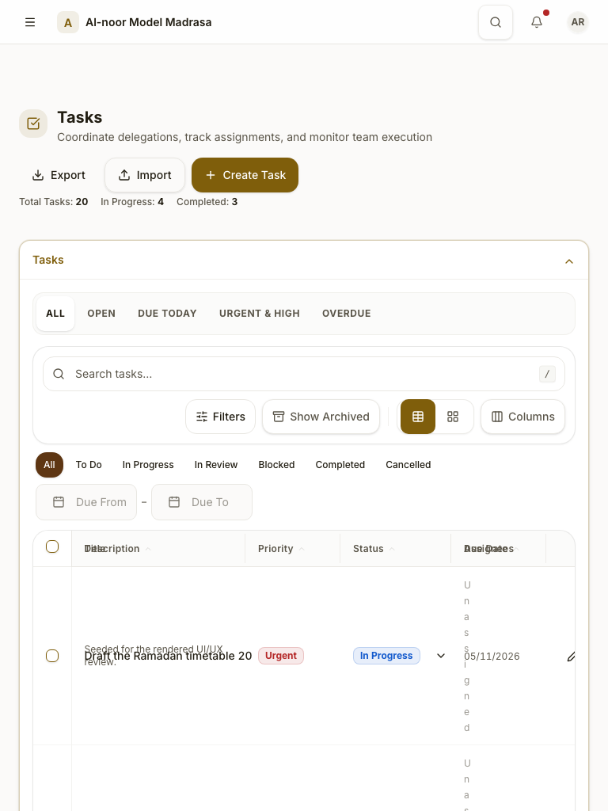
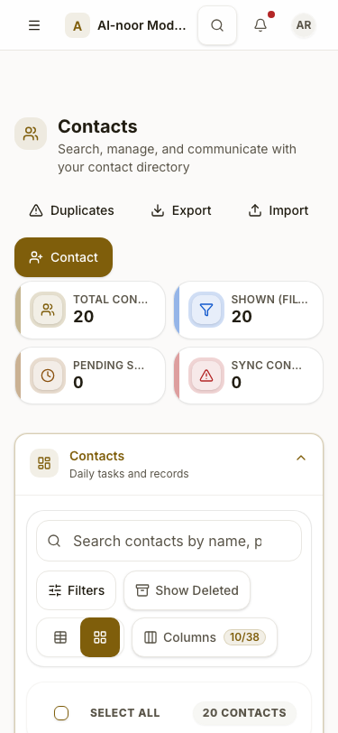
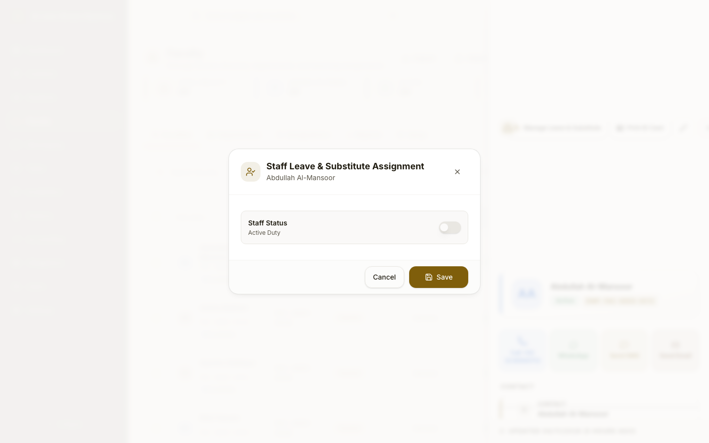
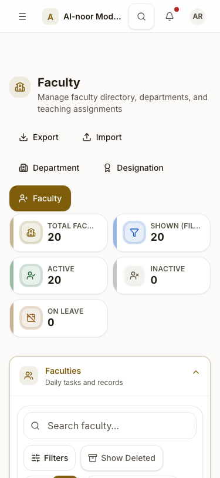
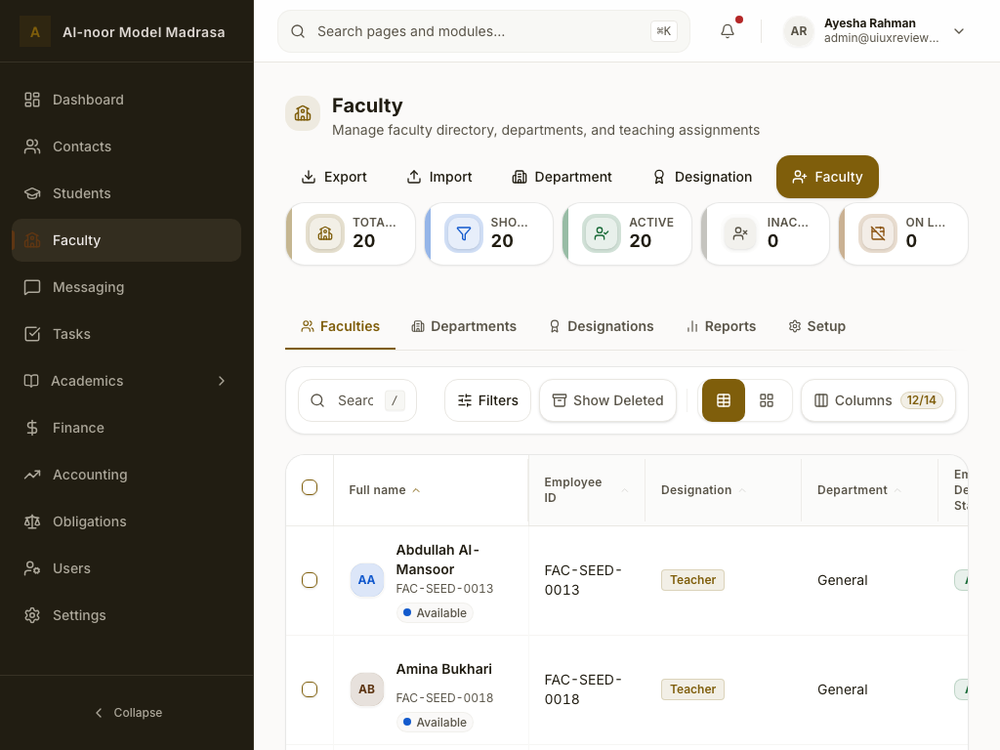
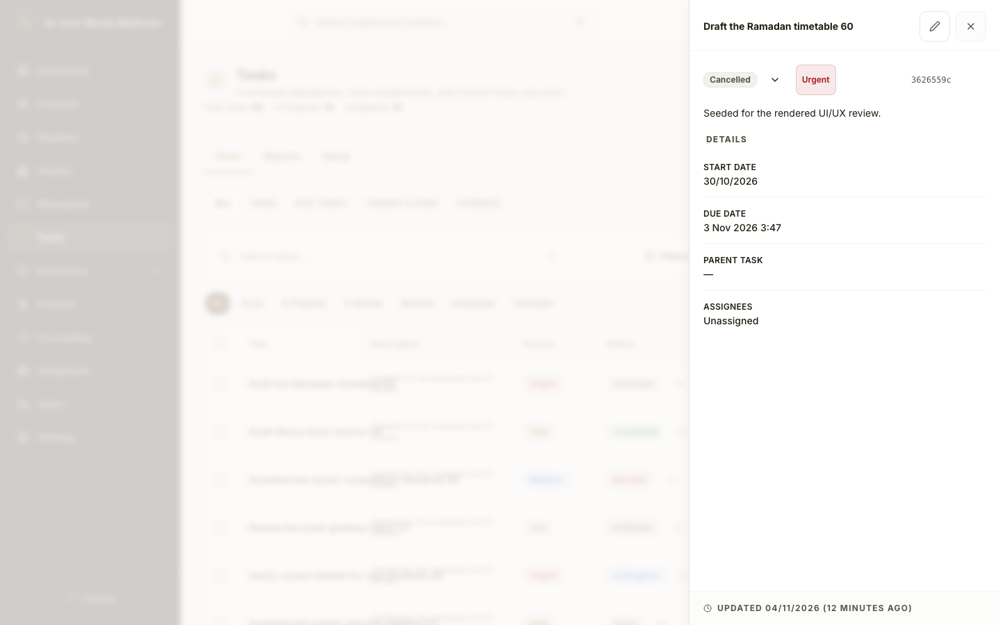
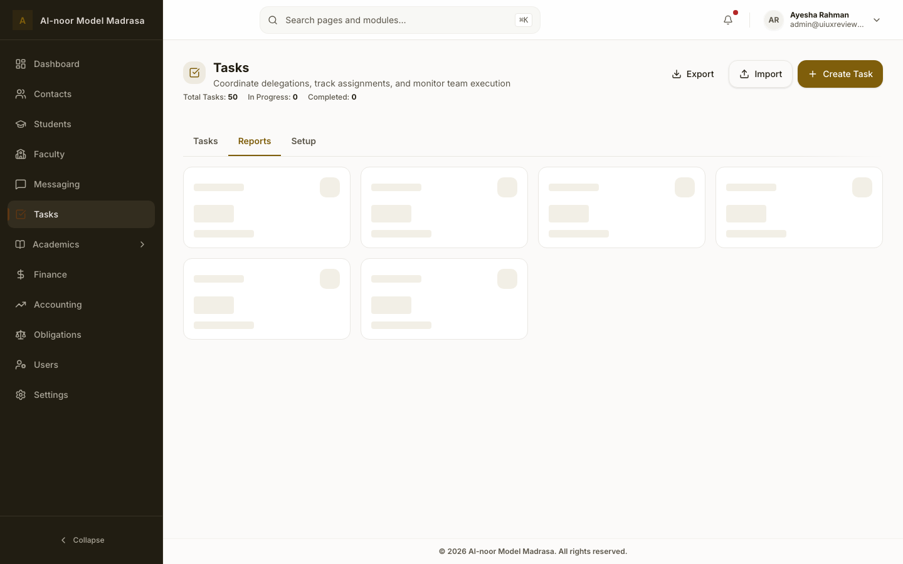
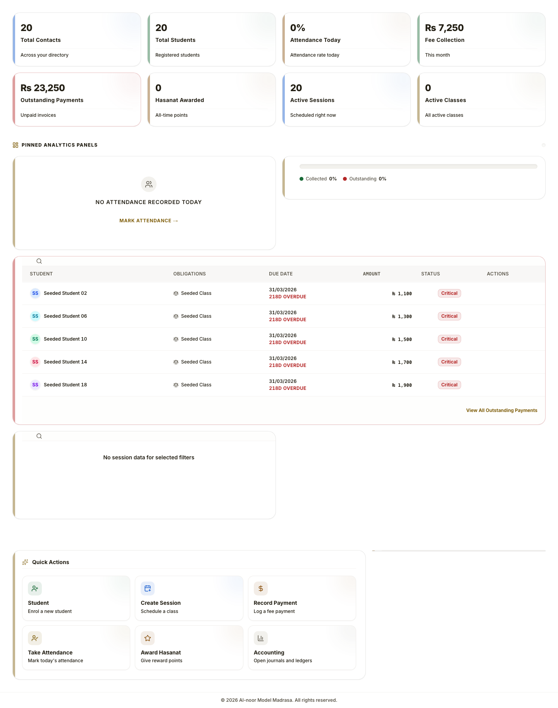
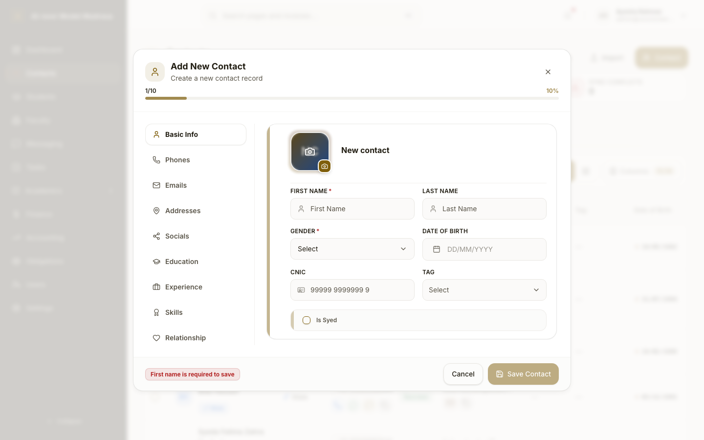
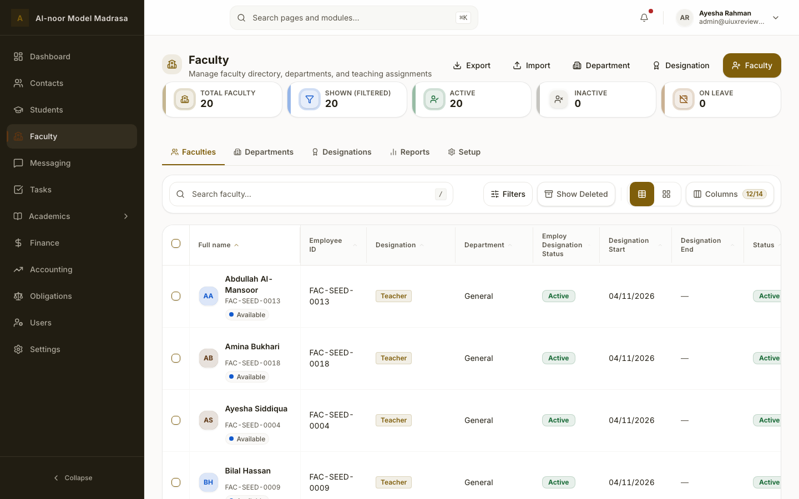

# UI/UX Review — Dashboard, Contacts, Students, Faculty, Tasks

Rendered-browser review of the five tenant modules at `main` HEAD `30abb1b41` plus the
unrelated backend/tasks changes already present in the working tree. No product code,
schema, API, or design-token change was made in this pass. The only code change is the
one-off review harness (`e2e/scripts/capture-ui-ux-review.mjs`).

| | |
|---|---|
| Environment | Local Vite `:5173`, Fastify `:3000`, Docker Postgres/Redis; Chromium via Playwright |
| Fixture | Synthetic `uiuxreview3799320531` tenant: 20 contacts, 20 students, 20 faculty, 60 tasks, 20 sessions/invoices |
| Corpus | **85 manifest captures** + 5 manual print/Persian captures; **35 curated** in `screenshots/` |
| Contexts | 1440 light/dark, 1024, 768, 375 light/dark; en, ar (1440), ur (375), fa (1024) |
| Gates | typecheck, lint, token-contrast 40/40, BiDi 0 violations, `check:i18n` 9,530 keys complete, UI audit advisory (4 files) |

## 1. Executive summary

The module architecture still reads as mature: shared scaffold, consistent page headers,
logical CSS, coherent dark mode, correct RTL mirroring, localized numerals, visible row
actions, and well-built drawers/forms. The rendered experience is less even.

Five defects dominate:

1. **The Tasks directory table breaks at tablet widths** — headers overlap and the
   Assignees column collapses to one character per line; even at 1440 the title text spills
   into the Description column (P1).
2. **KPI labels truncate across all directory modules** — at 1024 every label in the
   5-card strips is ellipsized (48–83 px available for 95–119 px text); at 375 the same
   happens in the 2-up grid; Tasks Reports also truncates its 6th card at 1440 (P1).
3. **Mobile tier headers sit below the active tier's content** — on Faculty the
   Departments header is at **y ≈ 7,959** of an 8,311 px page; switching tiers means
   scrolling the entire directory first (P1/P2).
4. **Directory tables overflow their container** — Faculty is 1,820 px wide in a 1,114 px
   desktop container; at 1024 Contacts/Students/Faculty are 1,400–1,820 px in 698 px,
   putting Status/Actions off-screen (P2).
5. **Interaction and failure states are dishonest or unreachable** — clicking a task's
   status trigger also opens the drawer; a dirty task form closes without a discard
   prompt; failed metric queries leave skeletons with no error or retry (P2).

Accessibility is not release-clean on the reviewed overlays: critical `button-name` in the
Faculty leave modal, critical `aria-required-children` in the Faculty contact picker,
serious `label-content-name-mismatch` in the Students import dropzone, and serious
`color-contrast` on Tasks' "Unassigned" and the open Contacts filter button.

**Overall: structurally A−, rendered UX B−.**

## 2. Scorecard

| Dimension | Grade | Rationale |
| --- | --- | --- |
| Visual hierarchy & composition | **C+** | Strong headers/cards; Tasks table collapse, dashboard length |
| Consistency & design-system use | **B−** | Tasks uses inline metrics and bare tabs; KPI truncation varies by module |
| Typography | **B−** | 12 px floor holds; labels ellipsized; title/description collision |
| Colour & theming | **B** | Dark mode coherent; six serious/critical axe findings |
| Interaction & feedback | **C+** | Good overlays; status menu opens drawer, dirty close loses work, failed metrics loop skeletons |
| Navigation & IA | **C+** | Clear desktop tiers; mobile tier headers below content |
| Forms & data entry | **B−** | Strong shared FormModal; pre-emptive errors, empty contact picker, unlabeled switch |
| Data display | **C** | Tables robust at 1440 except Tasks; 768/1024 break; wide tables hide status |
| Accessibility | **C** | 2 critical + 4 serious axe findings; drawer focus is correct |
| Responsive | **C** | 0 page overflow, but tablet table collapse and 6–8k mobile pages |
| i18n & BiDi | **B** | RTL mirrored, Arabic-Indic numerals; Persian/Arabic table clipping |
| Perceived performance | **B−** | Warm LCP 1.0–1.8 s; CLS up to 0.24 on dashboard@768 |
| Copy & terminology | **B−** | Clear overall; internal "messaging outbox/intents" copy, odd date icon |
| Trust & error recovery | **C+** | Empty states exist; failure states do not tell the truth |

## 3. Coverage

| Surface | Contexts |
| --- | --- |
| Dashboard home | 1440 light/dark, 1024, 768, 375 light/dark, ar, ur, fa |
| Contacts Work | same primary contexts, ar/ur/fa |
| Students Work | same |
| Faculty Work | same |
| Tasks Work | same |
| Overlays/states | dashboard customize/insights/error/print; contacts filters/bulk/drawer/form/import/duplicates/setup/reports/trash/empty; students drawer/form/setup/card-template/reports/import; faculty departments/designations/reports/setup/drawer/leave/form/designation modal; tasks status menu/form/import/reports/reports-error/setup/page 2/trash/empty |
| Probes | drawer focus + return, task status-vs-drawer, dirty task close, tier geometry, KPI label widths, table widths, contrast/axe |

Reproduction: `e2e/scripts/capture-ui-ux-review.mjs` (`--capture-five-modules`,
`--capture-five-module-locales`, `--capture-five-module-states`), corpus under
`.logs/ui-ux-review-2026-11-04/` (gitignored).

Additional curated evidence:
[dashboard ar](./screenshots/dashboard-1440-light-ar.png) ·
[dashboard fa](./screenshots/dashboard-1024-light-fa.png) ·
[contacts ur](./screenshots/contacts-375-light-ur.png) ·
[contacts bulk bar](./screenshots/contacts-bulk-bar-1440-light-en.png) ·
[students drawer](./screenshots/students-drawer-1440-light-en.png) ·
[students form](./screenshots/students-form-1440-light-en.png) ·
[students card template](./screenshots/students-card-template-1440-light-en.png) ·
[tasks form](./screenshots/tasks-form-1440-light-en.png).

## 4. Findings

### UX-01 · P1 — Tasks table collapses at 768–1024 and overlaps at 1440



At 768 and 1024 the table renders with compressed columns: the `Title` and `Description`
headers are superimposed, `Assignees` and `Due Date` overlap, and the Assignees cell is so
narrow that "Unassigned" renders one character per line, inflating every row to several
hundred pixels. At 1440 the same title link is 211 px wide inside a 177 px cell, spilling
~34 px into the Description column (visible in every row). The defect repeats in Arabic
and Persian.

- Evidence: `tasks-768-light-en.png`, `tasks-1024-light-en.png`, `tasks-1440-light-en.png`,
  `tasks-1440-light-ar.png`, `tasks-1024-light-fa.png`.
- Cause: `tenant/features/tasks/components/tasksWorkBatchColumns.tsx:31-35` renders the
  title through `TableCellLink` (a shared `Button` with `whitespace-nowrap`) with no
  clamp; the table keeps fixed column widths and compresses instead of switching to cards
  or scrolling.
- Direction: use cards below `lg` (the students/contacts pattern), or enforce per-column
  min-widths with horizontal scroll; clamp the title to 2 lines and truncate with a
  `title` fallback. Acceptance: no header overlap at 768/1024, no column below 80 px,
  row height ≤ 96 px, title never crosses its cell.

### UX-02 · P1 — KPI labels are ellipsized at 1024 and 375



Every directory module ellipsizes its command-centre labels. Measured label boxes:
375 px → **86 px** available for 95–119 px text (all four Contacts cards); 1024 px →
**48 px** for Students/Faculty (95–119 px) and **83 px** for Contacts. Tasks Reports at
1440 truncates its 6th card to "COMPLETIO…". The metric meaning is lost exactly where the
cards are densest.

- Evidence: `contacts-375-light-en.png`, `students-375-light-en.png`,
  `faculty-375-light-en.png`, `students-1024-light-en.png`, `faculty-1024-light-en.png`,
  `tasks-reports-1440-light-en.png`; measurements in the corpus manifest.
- Cause: `components/app/ModuleCommandMetricsGrid.tsx:24-35` maps 5 items to
  `lg:grid-cols-5` (1024) and 6 to `xl:grid-cols-6`; `components/app/StatCard.tsx:111`
  gives the compact label `truncate`.
- Direction: move 5/6-column layouts to `xl`, use 3 columns at `lg`, allow two-line labels
  (or a min-width + tooltip) at 375. Acceptance: every label fully readable at 375/1024,
  or exposed via `title` and a non-truncated accessible name.

### UX-03 · P1 — Critical/serious accessibility failures in module overlays



- **Faculty leave modal** — critical `button-name`: the Staff Status `Switch`
  (`FacultyLeaveModal.tsx:133`) has no accessible name; visible "Staff Status" copy is not
  associated.
- **Faculty form** — critical `aria-required-children` on `#contactId-listbox` plus a
  serious `color-contrast` on `.text-primary/70`; the picker renders a listbox with no
  options ("No contacts found").
- **Students import** — serious `label-content-name-mismatch` on the dashed dropzone: the
  `aria-label` does not contain the visible "Drop CSV file here" text.
- **Contacts filters** — serious `color-contrast` on the Filters trigger when the menu is
  open.

- Evidence: `faculty-leave-modal-1440-light-en.png`,
  `faculty-form-1440-light-en.png`, `students-import-1440-light-en.png`,
  `contacts-filters-1440-light-en.png`; axe results in the manifest.
- Direction: label the switch (or use `aria-labelledby`), render the picker's empty state
  outside the listbox role (or give it `role="status"`), make the dropzone label include
  the visible title, and remove the open-state opacity. Acceptance: axe serious/critical
  = 0 on these four overlays.

### UX-04 · P2 — On mobile, tier headers sit below the active tier's content



The mobile accordion places each tier's header above its body inside the same section.
With Work active, the next tier's header is pushed below the entire directory: Faculty
`Departments` header at **y ≈ 7,959** (page 8,311), `Reports` at 8,120, `Setup` at 8,201;
Contacts/Students/Tasks pages are 6.1–7.4k px with the same structure. Switching tier
requires scrolling past all 20 cards first. (When the last tier is active, its header is
conveniently at the top — the problem is directional.)

- Evidence: `faculty-375-light-en.png`, `contacts-375-light-en.png`,
  `students-375-light-en.png`, `tasks-375-light-en.png`; section geometry measured.
- Cause: `components/app/ResponsiveAccordionTabs.tsx:85-133` renders stacked sections and
  only the active section receives content; no sticky tier switcher.
- Direction: render a sticky segmented tier bar on mobile, or move all headers above the
  panel bodies and collapse inactive bodies. Acceptance: every tier is reachable within
  one viewport of the page top.

### UX-05 · P2 — Wide directory tables hide Status and Actions



At 1440 Faculty's table is **1,820 px** wide in a 1,114 px container; the Status and Actions
columns are off-screen. At 1024 Contacts/Students/Faculty measure **1,490 / 1,400 / 1,820
px** in a **698 px** container. There is no visible scroll affordance or frozen identifier
column; the right-edge "Status" badges are cut mid-pill.

- Evidence: `faculty-1440-light-en.png`, `faculty-1024-light-en.png`,
  `students-1024-light-en.png`, `contacts-1024-light-en.png`; measured boxes.
- Direction: make the default column set fit (fewer defaults, priority columns), freeze the
  identifier + Actions columns, and add a scroll shadow/“more columns” cue. Acceptance:
  Status + Actions visible at 1024 without horizontal scroll, or an explicit indicator.

### UX-06 · P2 — Task status trigger opens the detail drawer; dirty close discards work



Interaction probe: `dialogsBefore = 0`, `dialogsAfter = 1` after clicking the row's
Change Status trigger — the drawer opens too. Separately, typing a title and pressing
Escape closed the form with **no discard dialog** (`tasksDirtyCloseConfirm: false`);
`tasks-form-discard-1440-light-en.png` is the bare list with the draft gone. The form also
never receives the `saving` pending state.

- Evidence: `tasks-status-menu-1440-light-en.png`, `tasks-form-discard-1440-light-en.png`;
  `module-state-probes.json`.
- Cause: the status cell does not stop row-click propagation; `TaskFormModal` gets
  `isDirty` but no `discardUnsavedTitle`/description and no `saving` prop.
- Direction: stop propagation in the status cell; pass the shared discard props and
  `saving={create.isPending || update.isPending}`. Acceptance: status menu opens without a
  drawer; dirty close shows the shared confirm.

### UX-07 · P2 — Failed metric queries loop skeletons and hide the failure



With `/api/tasks/metrics` returning 500, Tasks Reports renders six skeleton cards
indefinitely and the header falls back to page length ("Total Tasks: 50, In Progress: 0,
Completed: 0") with no error or retry. The dashboard behaves similarly after an injected
summary 500: skeleton cards and empty panels, no message, no retry
(`dashboard-error-1440-light-en.png`).

- Evidence: `tasks-reports-error-1440-light-en.png`, `dashboard-error-1440-light-en.png`.
- Cause: both hooks surface `isLoading` only; `isError` is ignored and header counts fall
  back to rendered rows.
- Direction: render `ErrorState` + retry, stop the skeleton on error, and render `—` rather
  than a row count for an unknown total. Acceptance: failure is visible and retryable.

### UX-08 · P2 — Dashboard is long, empty, and its print snapshot loses identity



Dashboard is 2,657 px at 1440 and 4,488 px at 375. Attendance, fee, and sessions panels
occupy large empty areas; the insights section contains an empty "Enrollment Trends" chart
with a negative y-axis (10 → −20). The print snapshot (1,825 px) starts at the KPI cards:
no greeting, user, institution, or date; empty search pills and Quick Action tiles still
print.

- Evidence: `dashboard-1440-light-en.png`, `dashboard-375-light-en.png`,
  `dashboard-print-1440-light-en.png`, `dashboard-insights-1440-light-en.png`.
- Direction: collapse/shorten empty panels, hide non-actionable print chrome, add a print
  header with workspace/name/date, and give empty charts a text empty state instead of a
  flat axis. Acceptance: print includes identity/date; empty panels do not dominate the
  page.

### UX-09 · P2 — Tasks is visually a different module from its peers

Tasks uses plain inline text ("Total Tasks: 60 In Progress: 10 Completed: 10") where the
other four modules use KPI cards, and its tabs are bare labels without the icons/descriptions
the peers render. The result is a lower hierarchy and an inconsistent command centre, even
though the data is the same shape.

- Evidence: `tasks-1440-light-en.png`, `tasks-375-light-en.png`,
  `students-1440-light-en.png`, `faculty-1440-light-en.png`.
- Cause: `TasksPageView.tsx:89-104` hand-rolls the metrics strip and
  `useTasksPageController.ts:169-174` hand-builds tabs instead of `ModuleTierPage` +
  `ModuleCommandMetricsGrid`.
- Direction: adopt the shared scaffold/metrics; keep Tasks' custom quick filters and date
  range. Acceptance: Tasks header/tabs match peer rhythm at 1440/375.

### UX-10 · P2 — Contacts form shows an error before interaction; rows are oversized



The create form opens with a red "First name is required to save" in the footer before the
user touches anything. The directory's rows are ~87 px tall: name + gender badge + tag,
phone + four icon actions + WhatsApp badge, email + copy; only four rows fit in a 900 px
viewport, and "Is Syed" wraps in the header.

- Evidence: `contacts-form-1440-light-en.png`, `contacts-1440-light-en.png`.
- Direction: validate on submit/blur (or show a neutral hint until touched); move secondary
  phone actions into a menu; drop/compact low-value columns. Acceptance: no error before
  interaction; row density improves without losing actions.

### UX-11 · P2 — Faculty workload pill claims "Available" for every member



Every row/card shows "Available" with no class count; the workload producer is absent, so
the status is decorative. The Faculty form's contact picker also opens to "No contacts
found" despite 20 existing contacts.

- Evidence: `faculty-1440-light-en.png`, `faculty-form-1440-light-en.png`.
- Direction: hide the pill/column until a producer exists, or hydrate counts; load a
  default/recent contact list in the picker. Acceptance: no fabricated workload state; the
  picker shows selectable contacts or a truthful empty/search prompt.

### UX-12 · P3 — Remaining polish

- 5-card strips leave an orphan card at 375 (Students "New (30 days)", Faculty "On Leave");
  screenshots `students-375-light-en.png`, `faculty-375-light-en.png`.
- Tasks footer says "60 shown" while page 1 renders 50 rows (`tasks-page-2-1440-light-en.png`).
- Tasks Setup copy exposes internals ("Emit assignment notification intents to the messaging
  outbox") rather than user outcomes (`tasks-setup-1440-light-en.png`).
- Contacts/Emergency/Lunar sort options and the star icon before dates add terminology
  noise (`contacts-filters-1440-light-en.png`).

## 5. Cross-module consistency

| Surface | Contacts | Students | Faculty | Tasks | Verdict |
| --- | --- | --- | --- | --- | --- |
| Header metrics | 4 KPI cards | 5 KPI cards | 5 KPI cards | inline text | **Divergent (UX-02/09)** |
| Tabs | icon + description | icon + description | icon + description | bare labels | **Divergent (UX-09)** |
| Work default | table fit at 1440 | table overflows at 1024 | table overflows at 1440 | table breaks at 768–1024 | **Inconsistent** |
| Mobile tier switch | below content | below content | below content | below content | **Systemic (UX-04)** |
| Form discard | confirm | confirm | confirm | none | **Tasks gap (UX-06)** |
| Error state | list has ErrorState | list has ErrorState | reports ErrorState | reports loops skeleton | **Tasks/dashboard gap** |
| Empty state | clear + CTA | clear + CTA | clear + CTA | clear + CTA | Strong |
| RTL mirroring | correct | correct | correct | correct | Strong |

## 6. Prior-finding verification

| Prior item | Status | Evidence |
| --- | --- | --- |
| 2026-10-31 UX-04 row actions visible at rest | **HOLDS** | Actions icons visible on every row in contacts/students/faculty captures |
| 2026-10-31 UX-06 numerals localized | **HOLDS** | Arabic dashboard ٢٠/٠٪؜, Persian ۲۰/۰٪; Latin only for currency symbol/email |
| 2026-10-31 UX-08 dashboard greeting/height | **PARTIAL** | 1440 greeting 2 lines, height 2,657; 375 is 4,488 with empty panels (UX-08) |
| 2026-10-31 UX-14 five-metric grid | **PARTIAL** | 5 columns at 1440; 2-up at 375 leaves an orphan and truncates labels (UX-02/12) |
| 2026-10-31 UX-17 mobile density | **PARTIAL** | Card metadata compact, but 20 cards produce 6–8k pages and hide tier headers (UX-04) |
| 2026-10-31 tier collapse desktop fix | **HOLDS on desktop; new mobile issue** | Desktop tabs do not blank; mobile headers below content (UX-04) |
| Frontend review: Tasks status menu also opens drawer | **CONFIRMED** | Probe 0 → 1 dialog; screenshot (UX-06) |
| Frontend review: Tasks dirty close without confirm | **CONFIRMED** | Probe false; screenshot (UX-06) |
| Frontend review: Tasks reports failure shows zeros/skeleton | **CONFIRMED** | Injected 500 captures (UX-07) |
| Frontend review: Dashboard failure has no error state | **CONFIRMED** | Injected 500 capture (UX-07) |
| Frontend review: Faculty "All genders" empties list | **NOT REPRODUCED** | Probe could not open the filter menu after the tab switch; remaining hypothesis |
| Frontend review: setup draft loss, empty-page pagination | **NOT EXERCISED** | No destructive flow was run in this pass |

## 7. Accessibility evidence

- Axe (WCAG 2.1/2.2 A/AA, serious+critical): 3 of 26 primary Work captures fail — Tasks
  work/table at 1440, 1024 and 768 (`color-contrast`, 20 nodes each). Overlay/state failures
  are listed in UX-03; the other 23 primary Work captures are clean.
- Drawer focus: Contacts and Students open with focus inside the dialog and return focus to
  the opener on Escape (probe result).
- Touch targets: no page-level horizontal overflow in 85 captures; raw 16 px table header
  buttons retain the 44 px pseudo-element contract from the 2026-10-31 fix.
- Axe is partial evidence: no screen-reader, forced-colors, 200% zoom, or keyboard-only
  traversal was executed.

## 8. Responsive, BiDi, and performance evidence

- Page overflow: **0 px** on every capture; all width failures are inside scroll containers.
- Tablet is the weak breakpoint: Tasks table collapse (UX-01), wide tables (UX-05), KPI
  truncation at 1024 (UX-02).
- RTL: ar/ur/fa mirror correctly; Arabic-Indic numerals and localized dates hold; table
  clipping in RTL is a consequence of the same overflow (UX-05), not a separate bidi bug.
- CLS (warm dev server): dashboard @768 **0.243**, @1440-dark **0.170**; Tasks @768
  **0.186**, @1440 **0.131**; typical module CLS 0.017–0.07. LCP 0.98–1.8 s.
- No sub-12 px text found in the captured module chrome; the token floor holds.

## 9. Prioritized backlog

**P1 — fix before the next module release**

1. Tasks table responsive layout + title clamp (UX-01).
2. KPI label layout at 375/1024 (UX-02).
3. Faculty switch label, Faculty picker listbox, Students dropzone label, Tasks/Contacts
   contrast (UX-03).
4. Mobile tier switcher above content (UX-04).

**P2 — next patch**

5. Fit/freeze directory columns; add scroll cue (UX-05).
6. Stop row propagation from the status cell; wire save/discard (UX-06).
7. ErrorState + retry for dashboard and task metrics (UX-07).
8. Dashboard print header + empty-panel compression (UX-08).
9. Tasks scaffold/metric parity (UX-09).
10. Contacts pre-emptive error + row density (UX-10).
11. Faculty workload/picker truthfulness (UX-11).

**P3 — polish**

12. Orphan KPI card, footer shown-vs-total, setup copy, low-value columns (UX-12).

## 10. Limitations

Chromium only; synthetic tenant; dev server rather than a production build; warm-server
timings; no real users, assistive technology, zoom, or forced-colors pass. The Tasks
directory was seeded through the API for this review; the archive-seed DELETE calls failed
validation, so the trash capture shows the empty archive state. Axe is advisory and partial.
The working tree contains unrelated backend/tasks changes from another pass; they can change
task/dashboard data, not the layout findings. The mobile card-view captures for Contacts did
not complete; the table view was used for that module at 375. Persian captures were taken
manually after the locale
runner stalled on the Urdu Tasks page, so they are in the curated set but not in the
manifest.

## 11. Reproduction

```bash
UIUX_REVIEW_RUN=2026-11-04 node e2e/scripts/capture-ui-ux-review.mjs --provision
UIUX_REVIEW_RUN=2026-11-04 node e2e/scripts/capture-ui-ux-review.mjs --session
UIUX_REVIEW_RUN=2026-11-04 node e2e/scripts/capture-ui-ux-review.mjs --capture-five-modules
UIUX_REVIEW_RUN=2026-11-04 node e2e/scripts/capture-ui-ux-review.mjs --capture-five-module-locales
UIUX_REVIEW_RUN=2026-11-04 node e2e/scripts/capture-ui-ux-review.mjs --capture-five-module-states
```

Full corpus (gitignored): `.logs/ui-ux-review-2026-11-04/` (screens + `manifest.json` +
`module-state-probes.json`). Curated evidence: `screenshots/` in this folder.
